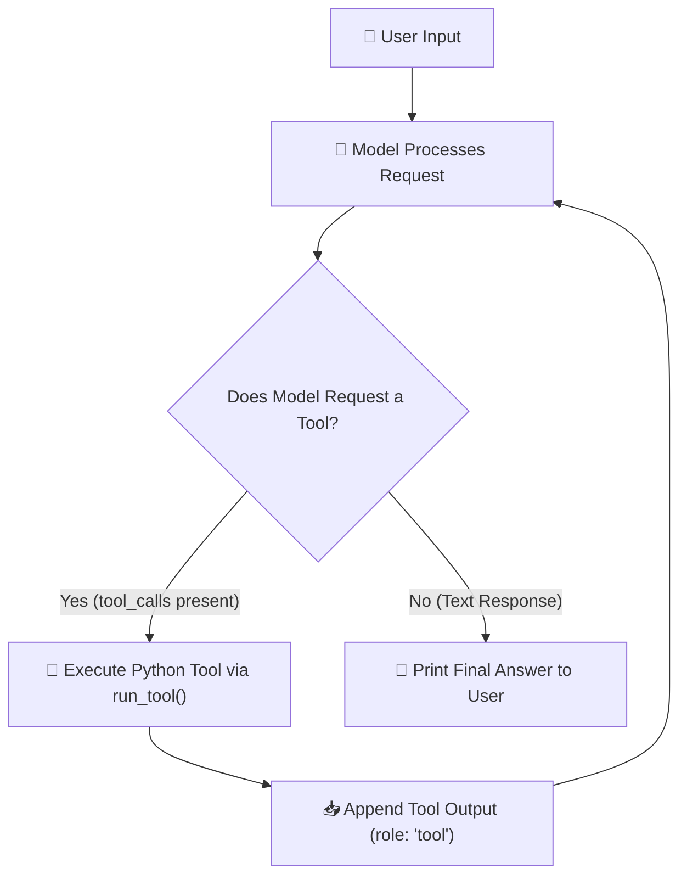

# 📐 Engineering Design System & Documentation Blueprint

<div align="center">

[](#-the-feynman-technique-principles)
[](#-visual--aesthetic-design-system)
[](#-the-fixed-logbook-template)
[](#-code-architecture--engineering-standards)

**A standardized, repeatable guide for structuring notes, architectures, diagrams, and implementations across the AI Engineering journey.**

---

</div>

<br />

## 🌟 1. Purpose & Vision

This repository documents the step-by-step construction of autonomous AI agents from scratch, following the **CodeWithMik AI Engineering playlist**. 

The goal of `DESIGN.md` is to establish a **strict, permanent standard** for all future notes, documentation entries in `LOGBOOK.md`, and code designs. 

Every milestone must not only work in code, but must also be documented so clearly and visually that anyone—whether an absolute beginner or an experienced software engineer—can immediately understand **how** it works and **why** it was designed that way.

---

## 🧠 2. Pedagogical Principles (How We Teach & Explain)

### A. The Feynman Technique (First-Principles Thinking)
Named after Nobel physicist Richard Feynman, this technique requires explaining complex ideas in the simplest language possible without losing technical accuracy.

1. **The "Curious 12-Year-Old" Rule:**  
   If a concept cannot be explained using everyday language and relatable real-world analogies, the concept is not yet fully understood. Avoid hiding behind dense academic jargon.
2. **Everyday Metaphors Before Code:**  
   Always ground abstract AI concepts in familiar real-world experiences before jumping into Python functions or API calls:
   - *Token limit* $\rightarrow$ A notebook with only 5 blank pages left.
   - *LLM Tool Calling* $\rightarrow$ A chef reading a recipe who calls an assistant to fetch ingredients.
   - *Agent Loop* $\rightarrow$ A detective investigating clues step-by-step until the case is solved.
3. **No Circular Definitions:**  
   Never explain a term using the term itself (e.g., *"Tool calling is when a model calls a tool"*). Instead: *"Tool calling is the process where the AI decides it needs fresh data or external actions, pauses its writing, and outputs a structured request asking your Python program to run a specific function for it."*
4. **Spot and Bridge Knowledge Gaps:**  
   If an explanation assumes prerequisite knowledge (e.g., JSON schemas, ANSI escape codes, HTTP status codes), pause for a 2-line visual breakdown to bridge the gap before continuing.

---

### B. Strict Lecture Sequence & Context Fidelity
1. **Preserve Lecture Chronology:**  
   Follow the exact flow of concepts and code examples in the **exact same order** presented in the lecture. Never scramble topics or introduce later concepts prematurely.
2. **Honor the Instructor's Pedagogical Progression:**  
   If the lecture starts with a manual implementation and refactors it into a helper function later, document the *exact transition* and the reasoning behind it.
3. **Explicit Boundary Separation:**  
   Clearly distinguish what was directly taught in the lecture from additional engineering enhancements (e.g., production guardrails, defensive error handlers, or local hardware optimizations).

---

### C. Atomic Deconstruction (Breaking Down Complexity)
1. **One Concept at a Time:** Never pack multiple major ideas into a single paragraph.
2. **Chunking:** Break complex processes down into discrete, numbered steps:
   - Step 1: User asks a question.
   - Step 2: Model determines if an external tool is required.
   - Step 3: Local script runs the Python function.
   - Step 4: Output is sent back to the model as role `tool`.
   - Step 5: Model synthesizes the final answer.

---

## 🎨 3. Visual & Aesthetic Design System

Documentation must be visually rich, attractive, and scannable. We combine high-contrast formatting, color cues, diagrams, and callouts to create an inviting reading experience.

### A. Visual Flowcharts & Diagrams
Every architectural decision, data flow, or multi-step execution loop **must** include a visual diagram using **Mermaid** or clean **ASCII art**.

#### Supported Diagram Types:
1. **Flowcharts (`flowchart TD` / `flowchart LR`):** For decision trees, step-by-step agent loops, and execution pipelines.
2. **Sequence Diagrams (`sequenceDiagram`):** For client-server-model communication (User $\leftrightarrow$ Python CLI $\leftrightarrow$ Ollama $\leftrightarrow$ External API).
3. **State Diagrams (`stateDiagram-v2`):** For tracking agent states (`IDLE`, `THINKING`, `TOOL_EXECUTING`, `RESPONDING`).



---

### B. Colorful Callouts & Alert Boxes
Use GitHub Flavored Markdown alerts strategically to emphasize critical points:

> [!NOTE]
> **Context & Implementation Details:** Use for background explanations, design choices, and conceptual context.

> [!TIP]
> **Performance & Best Practices:** Use for hardware optimizations, shortcuts, and clean code techniques.

> [!IMPORTANT]
> **Core Takeaways:** Use for must-know principles, non-negotiable architectural rules, and key formulas.

> [!WARNING]
> **Common Traps & Potential Bugs:** Use for edge cases, model hallucinations, formatting gotchas, and breaking changes.

> [!CAUTION]
> **Security & System Safety:** Use for API key exposure, memory overflows, or uncontrolled recursive loops.

---

### C. Visual Anchors & Emojis
Every section title and bullet must use standard, consistent emoji anchors to establish visual rhythm:

| Emoji | Meaning / Category | Purpose |
| :---: | :--- | :--- |
| 🎯 | **Learning Objective** | Defines what we are setting out to achieve |
| 🧠 | **Feynman Intuition** | Simple ELI12 analogy and intuitive breakdown |
| 🗺️ | **Architecture / Flow** | Visual diagram or system topology |
| 🔍 | **Deep-Dive Concepts** | Detailed technical mechanics and definitions |
| 💻 | **Code Walkthrough** | Implementation with line-by-line breakdown |
| 🧩 | **Before vs. After** | Code refactoring and evolutionary comparison |
| 🏆 | **Golden Takeaways** | The 3 most vital rules to remember |
| ⚠️ | **Gotchas & Bugs** | Real-world pitfalls and defensive solutions |
| 🎓 | **Interview Flashcards** | High-yield technical interview preparation |
| 🧪 | **Test Matrix** | Live verification results and test outputs |

---

### D. Keyword Highlighting & Formatting Rules
1. **Function & Variable Names:** Always wrap in code spans (e.g., `run_tool()`, `messages`, `MAX_STEPS`).
2. **Key Concepts & Patterns:** Bold on first mention with contextual capitalization (e.g., **Single Responsibility Principle**, **Bounded Execution Loop**).
3. **File Paths:** Always link to absolute paths or specific lines using GitHub-style Markdown links: `[tools.py](file:///c:/.../tools.py#L90-L105)`.
4. **Structured Tables:** Use clear column headers, centered emojis, and clean dividers for all comparisons.

---

## 📋 4. The Fixed LOGBOOK Template (Standardized Pattern)

Every new milestone added to `LOGBOOK.md` **must strictly follow this exact 11-part template**:

````markdown
---

## 🚀 [Phase X] - <Milestone Title from Lecture>

<div align="center">

[](https://youtube.com)
[](https://github.com)
[](https://github.com)
[](https://ollama.com)

</div>

> **Milestone Focus:** Video XX — <Exact Lecture Title>  
> **Status:** `COMPLETED`  
> **Prerequisites:** Phase X-1 (<Previous Milestone Title>)  
> **Hardware Profile:** Intel Core i3 (CPU Inference, Local Ollama, 0 API Cost)  

---

### 1. 🎯 Learning Objectives & Context

- **Primary Goal:** <One concise sentence on what this phase accomplishes.>
- **Key Subtopics:**
  1. <Subtopic 1 in lecture sequence>
  2. <Subtopic 2 in lecture sequence>
  3. <Subtopic 3 in lecture sequence>
- **Lecture Context:** <1-2 sentences summarizing how this lecture fits into the overarching AI Agent progression.>

---

### 2. 🧠 The Feynman Intuition (Explain Like I'm 12)

<Provide a vivid, relatable real-world analogy. No jargon. Break down the core mechanism into an intuitive mental model.>

> [!NOTE]
> **The Real-World Analogy:**  
> <Analogy text here, e.g., Imagine you are a detective...>

---

### 3. 🗺️ Visual Architecture & Execution Flow

<Visual diagram illustrating the complete execution cycle, client-model interaction, or internal state machine.>

```mermaid
flowchart TD
    <Mermaid nodes and flow definitions>
```

---

### 4. 🔍 Step-by-Step Concept Breakdown (In Lecture Order)

#### A. <Subtopic 1 Name>
<Clear, beginner-friendly explanation. Highlight key terms in **bold** and `code`.>

#### B. <Subtopic 2 Name>
<Clear, beginner-friendly explanation. Include tables or comparison blocks where relevant.>

#### C. <Subtopic 3 Name>
<Clear, beginner-friendly explanation.>

---

### 5. 💻 Code Walkthrough & Line-by-Line Anatomy

```python
# Clean, fully commented Python snippet showcasing the new functionality
```

#### 🔍 Line-by-Line Breakdown:
- **`Line X` (`code_element`):** <What this line does and why it was written this way.>
- **`Line Y` (`code_element`):** <What this line does and why it was written this way.>

---

### 6. 🧩 Before vs. After Code Evolution

| Feature / Pattern | Before (Phase X-1) | After (Phase X) | Architectural Benefit |
| :--- | :--- | :--- | :--- |
| **<Aspect 1>** | `<Previous implementation>` | `<New implementation>` | <Why this is better> |
| **<Aspect 2>** | `<Previous implementation>` | `<New implementation>` | <Why this is better> |

---

### 7. 🏆 The 3 Golden Takeaways

1. **<Takeaway 1 Title>:** <Clear explanation of core engineering rule.>
2. **<Takeaway 2 Title>:** <Clear explanation of core engineering rule.>
3. **<Takeaway 3 Title>:** <Clear explanation of core engineering rule.>

---

### 8. ⚠️ Common Traps & Real-World Gotchas

1. **<Trap 1 Name>:**  
   - *Problem:* <What went wrong or could go wrong.>
   - *Underlying Cause:* <Why it happened.>
   - *Defensive Fix:* <How we prevented or solved it.>

2. **<Trap 2 Name>:**  
   - *Problem:* <What went wrong or could go wrong.>
   - *Underlying Cause:* <Why it happened.>
   - *Defensive Fix:* <How we prevented or solved it.>

---

### 9. 🎓 Technical Interview Flashcards

**Q1: <Core conceptual interview question>?**  
> **Answer:** <Crisp, confident, technically sound answer in 2-3 sentences.>

**Q2: <Practical implementation interview question>?**  
> **Answer:** <Crisp, confident, technically sound answer in 2-3 sentences.>

**Q3: <Architectural trade-off interview question>?**  
> **Answer:** <Crisp, confident, technically sound answer in 2-3 sentences.>

---

### 10. 🧪 Live Verification & Test Matrix

Tested on local **Intel Core i3** running `qwen2.5:1.5b` with Ollama:

| Test Scenario / Input | Internal Execution / Debug Logs | Final Output Observed | Status |
| :--- | :--- | :--- | :---: |
| `"<Prompt 1>"` | `<Logs or tool calls>` | `"<Output>"` | ✅ **PASS** |
| `"<Prompt 2>"` | `<Logs or tool calls>` | `"<Output>"` | ✅ **PASS** |
| `"<Edge Case>"` | `<Handled error / fallback>` | `"<Output>"` | ✅ **PASS** |

---
````

---

## 🛠️ 5. Code Architecture & Engineering Standards

All Python code written in this repository must satisfy the following strict requirements:

### A. Minimal Dependencies & Zero Cloud Cost
- **Standard Stack Only:** `openai` (for standard client API protocol), `python-dotenv` (for `.env` loading), and `requests` (for external HTTP tool requests).
- **No Heavy Frameworks (Yet):** Do not introduce LangChain, LlamaIndex, LangGraph, or CrewAI until the playlist explicitly covers their underlying mechanisms from scratch.
- **Hardware-Aware Design:** All code must run smoothly on local **CPU inference** (Intel Core i3, ~1GB RAM footprint with `qwen2.5:1.5b`).

### B. Single Responsibility Principle (SRP)
- **`simple_ai_assistant.py`:** Dedicated strictly to handling the CLI chat loop, message history aggregation, and agent step coordination.
- **`tools.py`:** Dedicated strictly to tool definitions, JSON schemas, argument parsing, error boundaries, and tool execution (`run_tool()`).
- **`utilities/utilities.py`:** Dedicated strictly to reusable helpers (such as ANSI-colored debug logging).

### C. Defensive Programming & Guardrails
1. **Never Trust LLM Arguments Blindly:**
   - Always wrap tool JSON parsing in `try...except`.
   - Validate required keys before accessing them.
2. **Handle HTTP Failures Gracefully:**
   - Always call `response.raise_for_status()` when fetching data from external APIs.
   - Return clean string error messages so the agent can self-correct instead of crashing the program.
3. **Loop Bounds & Safeguards:**
   - Autonomous loops must always be bounded by a hard cap (`MAX_STEPS`).
   - Implement `for...else` exhaustion fallbacks.

### D. Clean Python Standards (PEP 8)
- Follow standard 3-tier import grouping:
  ```python
  # 1. Standard library
  import json
  import os
  from datetime import datetime

  # 2. Third-party packages
  from dotenv import load_dotenv
  from openai import OpenAI
  import requests

  # 3. Local project modules
  from tools import TOOLS, run_tool
  from utilities.utilities import log
  ```
- Use descriptive function and variable names (`get_city_weather` instead of `fetch_w`).
- Add docstrings explaining function arguments and return types.

---

## ✅ 6. Quality Checklist (Definition of Done)

Before any phase is marked `COMPLETED` and pushed to GitHub, verify that each item in this checklist is satisfied:

- [ ] **Lecture Alignment:** All concepts, examples, and tools match the exact order and context of the video lecture.
- [ ] **Feynman Clarity:** Explanations use simple English, clear real-world analogies, and avoid circular definitions.
- [ ] **Visual Appeal:** Includes at least one Mermaid or ASCII diagram, highlighted keywords, color badges, and structured tables.
- [ ] **Template Adherence:** All 10 sections of the fixed `LOGBOOK.md` template are fully fleshed out.
- [ ] **Live Testing:** Tested with `qwen2.5:1.5b` via local Ollama on the machine, including edge cases and error handling.
- [ ] **Git Hygiene:** Clean commit message following conventional commits (e.g., `feat(phase-X): ...`). `.env` remains untracked.
