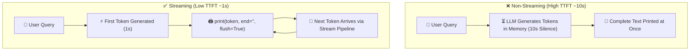
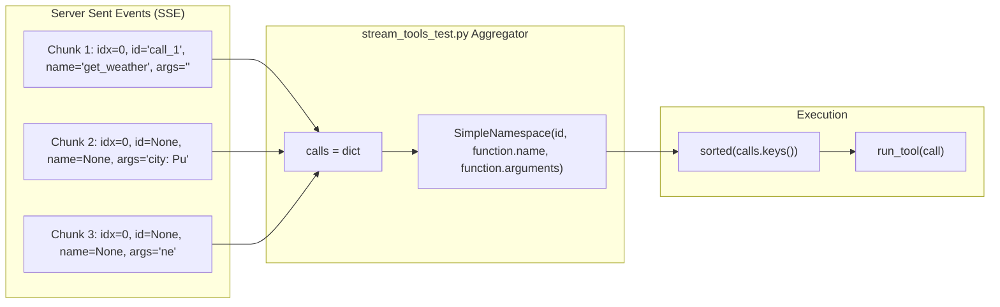
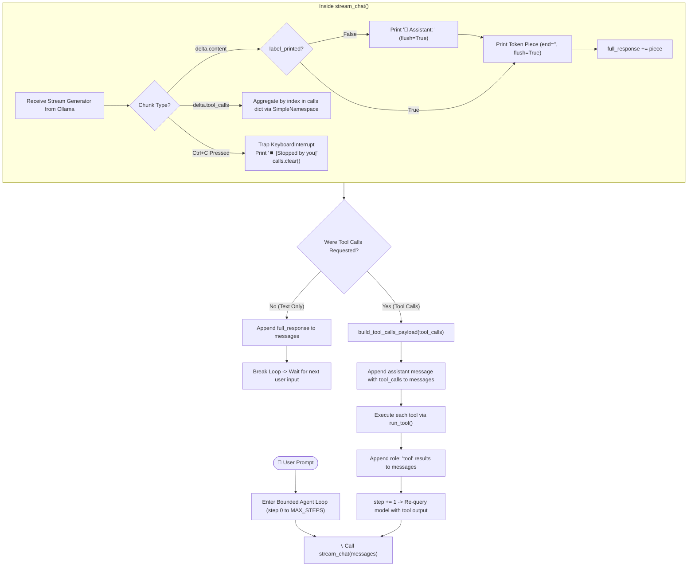
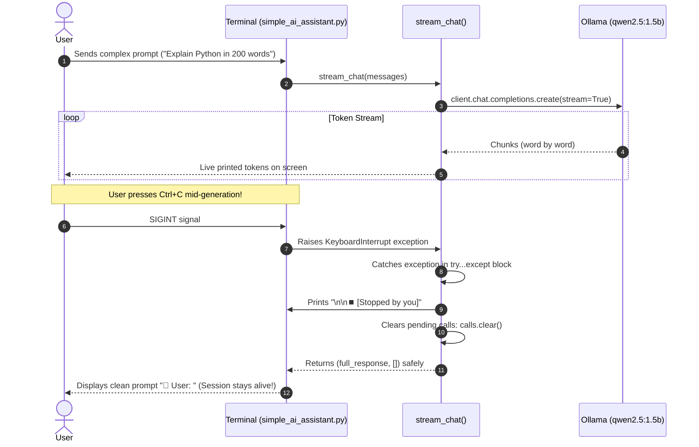

<div align="center">

# 🧠 Building Autonomous AI Agents From Scratch
### *A Developer's Production Engineering Logbook & Architecture Journal*

[](https://www.python.org/)
[](https://ollama.com/)
[](https://huggingface.co/Qwen/Qwen2.5-1.5B)
[](https://git-scm.com/)

---

*This logbook documents the step-by-step engineering progression from a raw one-shot script into a modular, production-ready, multi-step autonomous AI agent.*

</div>

<br />


---

## 🚀 [Phase 1] - Foundation, Local LLM Setup & Interactive Chat Loop

> **Milestone Focus:** Lectures 1–4  
> **Status:** `COMPLETED`  
> **Hardware Profile:** Intel Core i3 (CPU inference, 0 Cloud API cost)  
> **Active Model:** `qwen2.5:1.5b` (via local Ollama server on `:11434`)

```
┌─────────────────┐       HTTP REST (Port 11434)       ┌────────────────────────┐
│  Python Client  │ ─────────────────────────────────> │     Ollama Engine      │
│  (main script)  │ <───────────────────────────────── │ (qwen2.5:1.5b weights) │
└─────────────────┘             OpenAI Format          └────────────────────────┘
```

---

### 1. Executive Summary

In this milestone, we moved from zero to a fully operational, offline conversational AI assistant. Rather than relying on cloud APIs, we spun up a private local inference server. We established standard software engineering practices early:
- **Sandbox Isolation:** Enforced clean dependency tracking using virtual environments.
- **Config Decoupling:** Isolated sensitive connection URLs and model metadata from source code.
- **Continuous Session Runtime:** Built a resilient command-line interactive loop with graceful termination signals.

---

### 2. Deep-Dive Architectural Concepts (The "Why")

#### 🔒 Virtual Environment Isolation (`.venv`)
Global `pip` installs contaminate your operating system's base Python directory. If Project A depends on `library v1.0` and Project B requires `library v2.0`, updating one breaks the other. 

> [!NOTE]
> `.venv` creates a sandboxed directory containing its own Python executable and site-packages folder. Everything installed remains confined to this repository.

#### ⚡ Hardware-Conscious Model Selection (`qwen2.5:1.5b` vs `qwen3:4b`)
While larger parameter models offer broader world knowledge, they impose heavy computational overhead:

| Metric | `qwen3:4b` (4 Billion Params) | `qwen2.5:1.5b` (1.5 Billion Params) | Winner for Intel i3 |
| :--- | :--- | :--- | :--- |
| **RAM Footprint** | $\approx$ 3.2 GB to 4.0 GB | $\approx$ **986 MB** | **`1.5b`** (Prevents OS swapping) |
| **CPU Token Generation** | Slow / high thermal throttling | **Fast & responsive** | **`1.5b`** (Smooth CLI stream) |
| **Native Function Calling** | Full native support | **Full native support** | **Tie** |

#### 🌐 The OpenAI API Specification as an Industry Standard
Ollama serves models via an OpenAI-compliant REST interface at `http://127.0.0.1:11434/v1`. 

> [!TIP]
> By using `from openai import OpenAI` configured with our local `base_url`, the codebase remains portable. Swapping from local development to production OpenAI (`gpt-4o`) or Anthropic requires updating only configuration variables, not the agent logic.

#### 🧩 Configuration Decoupling (`.env` & `python-dotenv`)
Hardcoding secrets or addresses directly in application files creates technical debt and security risks:
- Built-in `os.getenv()` inspects RAM (`os.environ`).
- `python-dotenv` bridges physical storage and memory: `load_dotenv()` reads key-value pairs from `.env` on disk and populates the active process environment.

---

### 3. Terminal Command Reference

#### 📦 A. Environment & Dependencies

| Command | Action Performed | Engineering Purpose |
| :--- | :--- | :--- |
| `python -m venv .venv` | Generates `.venv/` sandbox | Prevents polluting system-level Python libraries. |
| `.\.venv\Scripts\Activate.ps1` | Activates environment | Points terminal session to isolated `.venv` binaries. |
| `python -m pip install openai python-dotenv` | Installs core client libraries | Direct binary execution avoids broken path launcher errors. |
| `python -m pip freeze > requirements.txt` | Pins package dependencies | Ensures environment reproducibility across machines. |

#### 🦙 B. Model Server Management (Ollama)

```powershell
# Pull and initialize model weights directly into local RAM
ollama run qwen2.5:1.5b

# Inspect all locally cached models and SHA256 identifiers
ollama list
```

#### 🐙 C. Version Control Workflow (Git)

```powershell
# 1. Initialize local repository
git init

# 2. Stage new files (respecting .gitignore)
git add .

# 3. Commit with standard semantic messaging
git commit -m "feat: implement baseline interactive assistant with dotenv and qwen2.5:1.5b"

# 4. Link to remote GitHub server & push
git branch -M main
git remote add origin https://github.com/<your-username>/ai-agent-scratch.git
git push -u origin main
```

---

### 4. Code Implementation & Walkthrough

File: `simple_ai_assistant.py`

```python
import os
from openai import OpenAI
from dotenv import load_dotenv

# -------------------------------------------------------------
# 1. Environment Configuration
# -------------------------------------------------------------
load_dotenv()

# -------------------------------------------------------------
# 2. Client Initialization (Targeting Local Ollama Engine)
# -------------------------------------------------------------
client = OpenAI(
    base_url=os.getenv("BASE_URL"),
    api_key=os.getenv("API_KEY")
)

model_name = os.getenv("MODEL")
print(f"🚀 Assistant online. Engine: [{model_name}]")
print("💬 Type 'exit', 'quit', or 'bye' to terminate.\n" + "-" * 50)

# -------------------------------------------------------------
# 3. Interactive REPL Chat Loop
# -------------------------------------------------------------
while True:
    try:
        user_input = input("\n👤 User: ").strip()
    except (KeyboardInterrupt, EOFError):
        print("\n\nSession terminated by user signal.")
        break

    # Graceful exit interceptor
    if user_input.lower() in ["exit", "quit", "bye", "goodbye"]:
        print("🤖 Assistant: Shutting down. Goodbye!")
        break

    # Avoid unnecessary inference on empty inputs
    if not user_input:
        continue

    # Dispatch payload to LLM
    response = client.chat.completions.create(
        model=model_name,
        messages=[
            {
                "role": "user",
                "content": user_input
            }
        ]
    )

    # Extract primary choice payload
    reply = response.choices[0].message.content
    print(f"🤖 Assistant: {reply}")
```

---

### 5. Engineering Analysis: Identified Cons & Trade-Offs

While functional, this baseline exhibits architectural bottlenecks:

```
[User Turn 1] "My name is Alex"     ──> [Sent: Turn 1 Only]     ──> Model acknowledges name
[User Turn 2] "What is my name?"    ──> [Sent: Turn 2 Only]     ──> Model: "I don't know your name"
```

> [!WARNING]
> **Defect 1: Statelessness & Lack of Memory**  
> Large Language Models maintain zero internal state between API calls. In our loop, `messages` is created brand new on each prompt. The model receives no history of previous turns.

> [!WARNING]
> **Defect 2: Rigid Personality & Behavior**  
> We haven't defined a system persona or operational guardrails. The model operates in default conversational mode without domain constraints or output formatting rules.

> [!WARNING]
> **Defect 3: Blocking I/O & High Latency**  
> The terminal blocks until the model finishes generating its entire completion before printing. There is no real-time word-by-word streaming.

---

### 6. The Bridge to Phase 2

To resolve **Defect 1**, the next milestone will introduce **Context & Memory Engineering**:

1. Initialize a long-lived conversation data structure: `messages = []`.
2. Append user input turns (`role: "user"`).
3. Append assistant responses (`role: "assistant"`).
4. Send the accumulated history array on every inference pass to enable multi-turn context retention.

---
## 🧠 [Phase 2] - Day 2: Memory Engineering & Handling LLM Statelessness

> [!IMPORTANT]
> **Milestone Goal:** Eliminate the assistant's short-term amnesia by maintaining an accumulating conversation history array (`messages = []`) across turns.

### 1. 📋 What We Built Today
We upgraded our baseline chatbot from a stateless single-turn responder into a stateful multi-turn conversational assistant. By capturing both `"user"` inputs and `"assistant"` replies inside a persistent list outside the main execution loop, the model can now reference earlier facts, names, and context within the active session.

---

### 2. 💡 Core Concepts: The "Why" Behind Each Decision

- **Statelessness of LLMs**
  - Large Language Models do not store session memory on their servers. The moment an API request completes, the model wipes its working memory clean—every new API call is treated like a brand-new conversation from a stranger.
- **The Context Illusion (How ChatGPT/Claude Remember)**
  - Applications simulate memory by recording the entire back-and-forth conversation locally and sending the **full message array** back to the model on every single turn. Role tags (`"user"` and `"assistant"`) let the LLM distinguish who said what.
- **The Context Window Catch**
  - Every LLM has a strict maximum token limit it can process in a single request (its **Context Window**). Because the entire message list is resent every turn, token usage grows continuously—eventually slowing down inference on CPU hardware, increasing API costs, or truncating older messages.

```text
Turn 1: [ User("Hi, I'm Abhishek") ] ──► LLM ──► Assistant("Hello Abhishek!")
Turn 2: [ User("Hi..."), Assistant("Hello..."), User("What's my name?") ] ──► LLM ──► Assistant("Your name is Abhishek.")
```

---

## 🎭 [Phase 3] - Day 3: System Prompts, Personas & RCTEF Framework

> [!IMPORTANT]
>
> **Milestone Goal:** Control the assistant's personality, tone, and output structure by pinning a `"system"` role instruction at the top of the message history.

### 1. 📋 What We Built Today
We gave our stateful assistant a defined persona and strict behavioral boundaries. By initializing `messages` with a `"system"` dictionary before the chat loop starts, every API call now instructs `qwen2.5:1.5b` on *how* to respond before it reads what the user asked.

---

### 2. 💡 Core Concepts: The "Why" Behind Each Decision

* **The `"system"` Role (Developer Instructions)**
  * Unlike `"user"` (human queries) and `"assistant"` (AI replies), `"system"` (called `"developer"` in newer OpenAI specs) sets global behavioral rules hidden from the end user.
* **Why It Goes Outside the Loop (Index `0`)**
  * Placing the system message once at index `0` ensures it stays permanently pinned at the top of every request without duplicating tokens on every loop iteration.
* **RCTEF Prompt Engineering Framework**
  * **R**ole (Persona) $\rightarrow$ **C**ontext (Scenario) $\rightarrow$ **T**ask (Goal) $\rightarrow$ **E**xamples (Few-shot) $\rightarrow$ **F**ormat & Constraints (Length/style limits).

---

### 3. 💻 Code Implementation (`simple_ai_assistant.py`)

```python
import os
from openai import OpenAI
from dotenv import load_dotenv

load_dotenv()

client = OpenAI(
    base_url=os.getenv("BASE_URL"),
    api_key=os.getenv("API_KEY")
)

model_name = os.getenv("MODEL")

SYSTEM_PROMPT = (
    "Role: You are a concise, humble, and practical AI Engineering Mentor. "
    "Context: You are helping a developer build AI agents from scratch in Python. "
    "Task: Answer questions clearly with practical reasoning. "
    "Constraints: Keep every response under 60 words. Use bullet points when listing steps."
)

# Pinned once at index 0 before the loop starts
messages = [
    {
        "role": "system",
        "content": SYSTEM_PROMPT
    }
]

while True:
    try:
        user_input = input("\nUser: ").strip()
    except (KeyboardInterrupt, EOFError):
        print("\nSession ended.")
        break

    if user_input.lower() in ["exit", "quit", "bye", "goodbye"]:
        print("Assistant: Goodbye!")
        break

    if not user_input:
        continue

    messages.append({"role": "user", "content": user_input})

    response = client.chat.completions.create(
        model=model_name,
        messages=messages
    )

    reply = response.choices[0].message.content
    print("Assistant: " + reply)

    messages.append({"role": "assistant", "content": reply})
```

---

## 🛠️ [Phase 4] - Tool Calling: Teaching Our AI to Use Real-World Tools (Modules 7 & 8)

> **Milestone Focus:** Modules 7 & 8: Function Calling & Tool Parameters  
> **Topic:** Tool Calling Basics & Functions with Parameters  
> **Status:** `COMPLETED`  
> **Hardware Profile:** Intel Core i3 (CPU inference, 100% Free / Local)  
> **Active Model:** `qwen2.5:1.5b` (via local Ollama server on `:11434`)  
> **New Role Learned:** `"tool"` (We now know all 4 roles: `"system"`, `"user"`, `"assistant"`, `"tool"`)

---

### 1. 🎯 The Big Problem & The Solution

Before this lecture, our AI was living inside a closed box. It only knew what it learned during training.

| User Question | ❌ Without Tools | ✅ With Tools (Phase 4) |
| :--- | :--- | :--- |
| **"What time is it now?"** | *"I cannot check the live time. I am just an AI."* | Calls `get_current_time()` $\rightarrow$ *"It is 8:30 PM."* |
| **"What is the weather in Delhi?"** | *"I don't have live internet data."* | Calls `get_city_weather("Delhi")` $\rightarrow$ *"Delhi is 23°C."* |
| **"Hi, how are you?"** | *"I am doing well! How can I help?"* | Speaks directly (no tools needed). |

> [!NOTE]
> **The Golden Rule of Tool Calling:**  
> **The AI NEVER runs the code.** The AI only *decides* which tool to call and extracts the arguments. **Your Python program runs the actual code.**

---

### 2. 💡 Easy Analogy: The Restaurant Menu

Think of tool calling like ordering food at a restaurant:

```text
1. The Menu (tools.py)        ──► You give the AI a menu of tools: "get_current_time", "get_city_weather".
2. The Order (LLM Decision)   ──► The AI cannot cook. It writes an order ticket: {"tool": "get_city_weather", "city": "Delhi"}.
3. The Kitchen (Python Code)  ──► Your Python program cooks the food (calls wttr.in weather API).
4. The Food (Tool Result)     ──► Python puts the result on a plate with the ticket ID (role="tool", tool_call_id=...).
5. The Serving (Final Answer) ──► The AI takes the food, adds polite words, and serves it to the user.
```

---

### 3. 🔄 How It Works Step-by-Step (The 2-API Call Dance)

Notice that for every question needing a tool, we make **TWO calls** to Ollama:

```text
User asks: "What is the weather in Delhi?"
   │
   ▼
[API Call #1] Send (Chat History + Tools Menu)
   │
   ▼
Ollama checks the query against tool descriptions.
AI says: "Please call get_city_weather with city='Delhi'." (finish_reason = "tool_calls")
   │
   ▼
Python runs: get_city_weather(city="Delhi")
Result from internet: "Delhi: ✨ +23°C"
   │
   ▼
Python adds this result to Chat History with role="tool"
   │
   ▼
[API Call #2] Send updated History (with tool result) to Ollama
   │
   ▼
AI reads the result and says nicely:
"The weather in Delhi is currently 23°C with clear skies!"
```

---

### 4. 🧩 The 4 Conversation Roles (Cheat Sheet)

Until now, we used 3 roles. Today we unlocked the 4th and final role:

| Role | Who uses it? | What is it for? |
| :--- | :--- | :--- |
| **`"system"`** | Developer (You) | Sets the AI's personality, rules, and limits (pinned at index 0). |
| **`"user"`** | Human | The question or prompt typed into the chat. |
| **`"assistant"`** | The AI Model | The AI's spoken reply OR its request to call a tool. |
| **`"tool"`** | Python Program | The raw answer returned by our function (requires `tool_call_id`). |

---

### 5. 💻 Code Walkthrough (Easy & Line-by-Line)

#### Part A: `tools.py` (Our Tool Box)

We keep all tools in a separate file so our code stays clean and organized.

```python
from datetime import datetime
import requests

# Tool 1: Simple function with NO parameters
def get_current_time():
    """Returns the current date and time as a string."""
    return datetime.now().strftime("%Y-%m-%d %H:%M:%S")

# Tool 2: Function WITH a parameter (city)
def get_city_weather(city: str):
    """Fetches real-time weather from wttr.in."""
    url = f"https://wttr.in/{city}?format=3"
    response = requests.get(url, timeout=10) # 10 sec safety timeout
    response.raise_for_status()              # Raise error if website fails
    return response.text.strip()
```

##### Describing Tools in JSON (The Menu Sent to AI)
The AI cannot read Python code, so we describe each function in a simple JSON format:

```python
TOOLS = [
    {
        "type": "function",
        "function": {
            "name": "get_current_time",
            "description": "Returns current local date and time. Use when user asks for time or date.",
            "parameters": {
                "type": "object",
                "properties": {},   # Empty because it needs no inputs
                "required": []
            }
        }
    },
    {
        "type": "function",
        "function": {
            "name": "get_city_weather",
            "description": "Returns live weather of a city. Use when user asks for weather or temperature.",
            "parameters": {
                "type": "object",
                "properties": {
                    "city": {
                        "type": "string",
                        "description": "Name of the city (e.g., Delhi, Seattle)"
                    }
                },
                "required": ["city"] # City is mandatory!
            }
        }
    }
]

# Simple dictionary mapping name (string) to real function
FUNCTION_NAME_TO_FUNCTION_MAP = {
    "get_current_time": get_current_time,
    "get_city_weather": get_city_weather
}
```

> [!TIP]
> **Why write good descriptions?**  
> The AI reads the `description` to decide whether to call your tool! If you write a bad description, the AI won't know when to use it.

---

#### Part B: `simple_ai_assistant.py` (The Brain Loop)

Here is how the main loop handles tool calling:

```python
# 1. First Call: Send messages AND the tools menu
response = client.chat.completions.create(
    model=model_name,
    messages=messages,
    tools=TOOLS
)

msg = response.choices[0].message

# 2. Did the AI ask to call a tool?
if msg.tool_calls:
    # Save the AI's tool request in history
    messages.append(msg)

    # Loop over every tool requested (AI can ask for 1 or more)
    for tool_call in msg.tool_calls:
        func_name = tool_call.function.name
        
        # Arguments come as a JSON string: '{"city": "Delhi"}'
        # json.loads() converts it into a Python dictionary: {"city": "Delhi"}
        func_args = json.loads(tool_call.function.arguments or "{}")

        # Find the function and run it!
        fn = FUNCTION_NAME_TO_FUNCTION_MAP[func_name]
        result = fn(**func_args) # Unpacks dictionary into arguments: fn(city="Delhi")

        # Append the tool result to history
        messages.append({
            "role": "tool",
            "tool_call_id": tool_call.id, # Links result to the specific tool call
            "content": str(result)
        })

    # 3. Second Call: Send updated history back to AI for final answer
    second_response = client.chat.completions.create(
        model=model_name,
        messages=messages
    )
    final_reply = second_response.choices[0].message.content or ""
    print("Assistant: " + final_reply)
    messages.append({"role": "assistant", "content": final_reply})

else:
    # Normal chat (no tools needed)
    reply = msg.content or ""
    print("Assistant: " + reply)
    messages.append({"role": "assistant", "content": reply})
```

---

### 6. 🔍 Two Special Python Tricks Explained

#### Trick 1: `json.loads(...)`
- **What it does:** The AI sends arguments as a plain text string: `'{"city": "Seattle"}'`.
- **Why we need it:** Python cannot read keys from a string. `json.loads()` converts that text into a real Python dictionary: `{"city": "Seattle"}`.

#### Trick 2: The Double Star `**` (Dictionary Unpacking)
- **What it does:** If you have `args = {"city": "Seattle"}`, calling `fn(**args)` turns into:
  `fn(city="Seattle")`.
- **Why we need it:** We don't have to write custom `if/else` checks for every single parameter. Python automatically unpacks any dictionary keys into function arguments!

---

### 7. ⚠️ Common Mistakes & Traps to Avoid

1. **Thinking the AI runs the code:**  
   ❌ *Mistake:* Assuming Ollama connects to the internet.  
   ✅ *Truth:* Ollama only outputs the text `"get_city_weather"`. Your Python code calls the internet.

2. **Forgetting `json.loads()`:**  
   ❌ *Mistake:* Passing `tool_call.function.arguments` directly to the function.  
   ✅ *Truth:* It is a string, not a dictionary. Always parse it with `json.loads()`.

3. **Missing `tool_call_id`:**  
   ❌ *Mistake:* Forgetting to include `"tool_call_id": tool_call.id` in the tool message.  
   ✅ *Truth:* The API will crash with an error because it doesn't know which tool call the result belongs to.

4. **Forgetting to append the AI's request:**  
   ❌ *Mistake:* Appending the tool result without first appending `messages.append(msg)`.  
   ✅ *Truth:* History must stay continuous: Request $\rightarrow$ Tool Output $\rightarrow$ Final Answer.

---

### 8. 🎓 Quick Interview Flashcards

**Q1: What is Tool Calling (Function Calling)?**  
> **Answer:** It is a feature where we give the LLM a list of functions. If the LLM needs external data, it pauses and tells our code which function to call and with what arguments. Our code runs the function and gives the result back to the LLM.

**Q2: Why does tool calling require two API calls?**  
> **Answer:**
> - Call #1: Asks the LLM which tool to use.
> - Call #2: Sends the tool's result back so the LLM can write a friendly answer for the user.

**Q3: What does the `**` operator do when calling `fn(**func_args)`?**  
> **Answer:** It is the dictionary unpacking operator. It takes a dictionary like `{"city": "Delhi"}` and passes it as keyword arguments: `fn(city="Delhi")`.

**Q4: What happens if a user asks a normal question like "Tell me a joke"?**  
> **Answer:** The LLM checks its tools menu, sees that no tool is needed, and answers directly with text in Call #1 (`msg.tool_calls` is `None`).

---

### 9. 🧪 Verification & Results

We tested our assistant on an **Intel i3** with `qwen2.5:1.5b`:

| Query | Tool Used | Result |
| :--- | :--- | :--- |
| `"What time is it now?"` | `get_current_time()` | ✅ Answered with live local time. |
| `"What is the weather in Delhi?"` | `get_city_weather(city="Delhi")` | ✅ Queried wttr.in and reported 23°C. |
| `"Tell me a one-sentence tip."` | *None* | ✅ Direct natural language answer. |

---

### 10. 🚀 The Bridge to Phase 5
In Phase 4, our assistant learned to call tools, but it was limited to **just one tool round** per question. In Phase 5, we remove that limitation and build the true **Agent Loop**!

---

## 🤖 [Phase 5] - Chained Tool Calling: Building The Autonomous Agent Loop (Module 9)

> **Milestone Focus:** Module 9: Chained Tool Calling & The Autonomous Agent Loop  
> **Topic:** Chained (Sequential) Tool Calling, The Agent Loop & Production Safety  
> **Status:** `COMPLETED`  
> **Hardware Profile:** Intel Core i3 (CPU inference, 100% Free / Local)  
> **Active Model:** `qwen2.5:1.5b` (via local Ollama server on `:11434`)  
> **Key Milestone:** **The official birth of our AI Agent!** We moved from a static chatbot to an autonomous agent.

---

### 1. 🌟 The Big Shift: AI Assistant vs. AI Agent

What is the real difference between an AI Assistant and an AI Agent?

| Feature | 💬 AI Assistant (Videos 1–8) | 🤖 AI Agent (Video 9) |
| :--- | :--- | :--- |
| **How it works** | Single question $\rightarrow$ Single answer. | Autonomous loop: Thinks $\rightarrow$ Acts $\rightarrow$ Observes $\rightarrow$ Repeats until goal is met! |
| **Tool Execution** | Only 1 tool round per user question. | Chains multiple tools one after another if needed. |
| **Independence** | Relies on user to supply all parameters. | Figures out missing information by calling helper tools on its own. |
| **Loop Architecture** | Static single `if msg.tool_calls` check. | **The Agent Loop:** A bounded `for step in range(MAX_STEPS)` loop. |

> [!NOTE]
> **What is an AI Agent?**  
> *"An AI Agent is an intelligent software system that perceives its environment, makes decisions, and takes autonomous actions in a loop to achieve specific goals."*

---

### 2. 🔍 Parallel vs. Chained (Sequential) Tool Calling

Not all multi-tool questions are the same. Let's compare the two kinds of tool calls:

#### Case 1: Parallel Tool Calls (Independent)
> **User Question:** *"What is the weather in Bangalore AND what is the current time?"*

```text
               User Query + Tools
[Assistant] ────────────────────────► [Ollama LLM]
    │                                      │
    │  ◄───────────────────────────────────┘
    │   AI says: "Call get_city_weather('Bangalore') AND get_current_time()"
    ▼
Both tools are completely INDEPENDENT.
Python runs both tools in 1 step, sends both results back, and AI gives the final answer.
```

#### Case 2: Chained / Sequential Tool Calls (Dependent)
> **User Question:** *"What is the weather of the city where I live?"*

```text
               User Query + Tools
[Assistant] ────────────────────────► [Ollama LLM]
    │                                      │
    │  ◄───────────────────────────────────┘
    │   AI says: "First, call get_user_city()." (Step 1)
    ▼
Python runs: get_user_city() ──► Returns "Bangalore"
    │
    │          Sends "Bangalore"
    └───────────────────────────────► [Ollama LLM]
                                           │
       ◄───────────────────────────────────┘
        AI says: "Now call get_city_weather('Bangalore')!" (Step 2)
    ▼
Python runs: get_city_weather("Bangalore") ──► Returns "22°C"
    │
    │          Sends "22°C"
    └───────────────────────────────► [Ollama LLM]
                                           │
       ◄───────────────────────────────────┘
        AI says: "You live in Bangalore, and it is 22°C outside!" (Step 3: Final Answer)
```

> [!IMPORTANT]
> **Why is this called "Chained"?**  
> Because Tool #2 (`get_city_weather`) **depends on the output of Tool #1** (`get_user_city`). They cannot run at the same time. They form a sequential **chain of actions**!

---

### 3. ⚠️ The Fatal Flaw in Our Phase 4 Code

In Video 8, our code had this structure:
```python
# Old Phase 4 Code (Broken for chained tools!)
response = client.chat.completions.create(...)
if msg.tool_calls:
    for tool_call in msg.tool_calls:
        # Run tool
    second_response = client.chat.completions.create(...)
    print(second_response.choices[0].message.content) # Assumed this is ALWAYS text!
```

**What broke?**  
When the user asked *"What is the weather where I live?"*:
1. Call #1 asked for `get_user_city`.
2. Python ran it and sent `"Bangalore"` in Call #2.
3. In Call #2, the model requested `get_city_weather("Bangalore")`.
4. But our old code **never checked for tools a second time!** It blindly printed `message.content` (which was empty), completely dropping the weather tool call!

---

### 4. 🔄 The Solution: The Autonomous Agent Loop

To fix this, we replace the single `if` check with an **autonomous loop**.

```text
┌────────────────────────────────────────────────────────────────────────┐
│                         THE AGENT LOOP CYCLE                           │
└────────────────────────────────────────────────────────────────────────┘

                   ┌─────────────────────────────┐
                   │   Start Round (step < MAX)  │
                   └──────────────┬──────────────┘
                                  │
                                  ▼
                   ┌─────────────────────────────┐
                   │    Call LLM with History    │
                   └──────────────┬──────────────┘
                                  │
                                  ▼
                     Did LLM request tool_calls?
                                ╱   ╲
                       NO      ╱     ╲      YES
                              ╱       ╲
                             ▼         ▼
             ┌─────────────────┐     ┌───────────────────────────────────┐
             │ Final Answer!   │     │ 1. Append assistant request msg   │
             │ Print to user   │     │ 2. Run requested tool(s)          │
             │ BREAK loop      │     │ 3. Append role="tool" result      │
             └─────────────────┘     └─────────────────┬─────────────────┘
                                                       │
                                                       ▼
                                            Loop back to next round!
```

---

### 5. 🛡️ Two Serious Dangers & Production Safety Fixes

An autonomous agent loop is powerful, but dangerous if left unprotected. We introduced **two crucial safety guardrails**:

#### Danger 1: The Infinite Loop Trap
- **The Risk:** An LLM is non-deterministic. If it gets confused or hallucinating, it might keep calling tools back and forth forever (`while True:` never stops). This wastes tokens, freezes your computer, or runs up massive API bills.
- **The Fix (`MAX_STEPS`):** Replace `while True` with a hard step limit:
  ```python
  MAX_STEPS = 5
  for step in range(MAX_STEPS):
      # Agent loop body
  ```

#### Danger 2: Crashing Tool Functions
- **The Risk:** What if wttr.in is down? What if the network times out? What if a tool raises an unhandled `Exception`? The whole Python program crashes!
- **The Fix (`try ... except`):** Wrap every tool call in error handling. If a function fails, don't crash! Instead, convert the error into a polite message and pass it back to the LLM:
  ```python
  try:
      fn = FUNCTION_NAME_TO_FUNCTION_MAP[func_name]
      result = fn(**func_args)
  except Exception as e:
      result = f"Error while running {func_name}: {e}"
  ```
  The LLM will read the error message and politely tell the user what happened!

#### 🐍 Python Pro-Trick: The `for ... else` Pattern
In Python, a `for` loop can have an `else` block:
```python
for step in range(MAX_STEPS):
    if not msg.tool_calls:
        break # Success! Normal exit.
else:
    # This ONLY runs if the loop completed ALL steps without hitting 'break'!
    print("Sorry, I could not complete this task within the step limit.")
```
This gives us a clean fallback when the model exhausts all its allowed attempts!

---

### 6. 💻 Complete Code Walkthrough

#### 📁 `tools.py` (New Tool Added: `get_user_city`)

```python
# 1. New helper tool to look up user location
def get_user_city():
    """Returns the city where the user lives."""
    return "Bangalore"

# 2. Tool schema menu sent to model
TOOLS = [
    # get_current_time schema...
    # get_city_weather schema...
    {
        "type": "function",
        "function": {
            "name": "get_user_city",
            "description": "Returns the user's home city (e.g. Bangalore). MUST be called when user asks about 'where I live', 'my city', or their location.",
            "parameters": {
                "type": "object",
                "properties": {},
                "required": []
            }
        }
    }
]

# 3. Dispatch mapping
FUNCTION_NAME_TO_FUNCTION_MAP = {
    "get_current_time": get_current_time,
    "get_city_weather": get_city_weather,
    "get_user_city": get_user_city
}
```

#### 📁 `simple_ai_assistant.py` (The Safe Agent Loop)

```python
MAX_STEPS = 5  # Safety boundary: Maximum allowed model rounds

while True:
    user_input = input("\nUser: ").strip()
    if user_input.lower() in ["exit", "quit", "bye"]:
        break
    if not user_input:
        continue

    messages.append({"role": "user", "content": user_input})

    # The Autonomous Agent Loop
    for step in range(MAX_STEPS):
        response = client.chat.completions.create(
            model=model_name,
            messages=messages,
            tools=TOOLS
        )

        msg = response.choices[0].message

        # Case 1: Model finished thinking and gave a text answer
        if not msg.tool_calls:
            reply = msg.content or ""
            print("Assistant: " + reply)
            messages.append({"role": "assistant", "content": reply})
            break # Exit loop successfully!

        # Case 2: Model wants to call one or more tools
        messages.append(msg)

        for tool_call in msg.tool_calls:
            func_name = tool_call.function.name
            try:
                func_args = json.loads(tool_call.function.arguments or "{}")
                fn = FUNCTION_NAME_TO_FUNCTION_MAP[func_name]
                result = fn(**func_args)
            except Exception as e:
                # Capture error without crashing
                result = f"Error while running {func_name}: {e}"

            # Append tool result to history so model can see it on next step
            messages.append({
                "role": "tool",
                "tool_call_id": tool_call.id,
                "content": str(result)
            })

    else:
        # Runs ONLY if MAX_STEPS was reached without a break
        fallback_msg = "Sorry, I could not complete your request within the maximum allowed step limit."
        print("Assistant: " + fallback_msg)
        messages.append({"role": "assistant", "content": fallback_msg})
```

---

### 7. 🏆 The Three Most Important Takeaways

1. **Chained Tools are Sequential:** When Tool B needs the result of Tool A, they cannot be called at the same time. The agent must run them one after another in sequential rounds.
2. **The Agent Loop Enables Autonomy:** By placing the LLM call and tool execution inside a loop, the model can iteratively reason, act, observe the result, and take further action without human intervention.
3. **Always Bound Your Agent:** Never write an unbounded agent loop. Always enforce a `MAX_STEPS` safety ceiling and wrap tool execution in `try ... except` blocks.

---

### 8. 🚧 Real-World Limitations of the Agent Loop (Interview Must-Know!)

In an interview, you must be able to explain the trade-offs and limits of this design:

1. ⏱️ **Latency & Token Cost:** Each step requires a full network round-trip to the model and adds messages to the conversation history, increasing CPU time and token usage.
2. ⛓️ **Cascading Errors:** If Tool #1 returns bad data, Tool #2 receives garbage input. The error compounds across steps.
3. 🧠 **Small Models Struggle with Multi-Step Planning:** Smaller models (like 1.5B–3B parameters) can get confused, miss dependencies, or call tools in the wrong order compared to larger frontier models.
4. 🎲 **Non-Deterministic Behavior:** Because LLMs are probabilistic token predictors, they might choose different tools or different orders on different runs, making bugs harder to reproduce.
5. 🛡️ **Prompt Injection Security Risks:** If a tool fetches content from an untrusted external source (like a web page or user email) that contains hidden malicious instructions, the LLM might be tricked into executing unauthorized tools!

---

### 9. 🎓 Quick Interview Flashcards

**Q1: What is the difference between Parallel Tool Calling and Chained Tool Calling?**  
> **Answer:**
> - **Parallel Tool Calling:** The tools are independent of each other (e.g. check time + check weather in Paris). The model requests both in a single turn.
> - **Chained Tool Calling:** Tool B depends on the output of Tool A (e.g. find user's city first, then look up weather for that city). They run in sequential steps.

**Q2: Why is the chained tool loop called the "Agent Loop"?**  
> **Answer:** Because the system autonomously loops through the cycle of **Perceive $\rightarrow$ Decide $\rightarrow$ Act $\rightarrow$ Observe** until it reaches the goal, without asking the human to do the intermediate steps.

**Q3: Why should you never use `while True` for tool calling in production?**  
> **Answer:** Because an LLM could get stuck in an infinite loop requesting tools repeatedly. A hard limit like `MAX_STEPS` prevents runaway costs, CPU hanging, and denial of service.

**Q4: How does Python's `for ... else` construct help in agent architectures?**  
> **Answer:** The `else` block only runs if the loop exhausts all iterations without hitting a `break`. This provides a clean way to detect when the agent failed to finish within `MAX_STEPS` and deliver a graceful fallback response.

---

### 10. 🧪 Live Verification & Test Results

Tested on local **Intel Core i3** running `qwen2.5:1.5b` with Ollama:

| Test Query | Steps Taken | Tools Executed | Final Outcome |
| :--- | :--- | :--- | :--- |
| `"Tell me the weather of the city where I live."` | 2 Rounds | 1. `get_user_city()` $\rightarrow$ Bangalore<br>2. `get_city_weather("Bangalore")` $\rightarrow$ 22°C | ✅ *"You live in Bangalore. The weather in your city is currently sunny with a temperature of +22°C."* |
| `"What time is it now?"` | 1 Round | `get_current_time()` | ✅ Returned live local time cleanly. |
| `"What is the weather in Delhi?"` | 1 Round | `get_city_weather("Delhi")` | ✅ Queried wttr.in and reported 20°C. |
| `"exit"` | 0 Rounds | *None* | ✅ Clean shutdown with *"Assistant: Goodbye!"* |

---

## 🧹 [Phase 6] - Refactoring, Clean Code & Debug Logging (Module 10)

> **Milestone Focus:** Module 10: Code Refactoring & Debug Logging  
> **Topic:** Code Refactoring, Centralized Debug Logging, ANSI Terminal Colors & Bug Fixes  
> **Status:** `COMPLETED`  
> **Hardware Profile:** Intel Core i3 (CPU inference, 100% Free / Local)  
> **Active Model:** `qwen2.5:1.5b` (via local Ollama server on `:11434`)  
> **Key Goal:** Make our codebase modular, clean, and production-ready with professional observability.

---

### 1. 🎯 Why Refactor Now? (The "Why")

As our AI Assistant grew into an autonomous AI Agent, our code was becoming crowded:
- Tool execution logic was tangled inside the conversation loop.
- When something failed, we had no visibility into what the AI was thinking or which tools it attempted to run.
- Minor hidden bugs (like missing required schema tags or `None` string concatenation) could silently crash the program.

```text
Before Video 10 (Messy & Blind):
┌──────────────────────────────────────────────────────────┐
│ simple_ai_assistant.py                                   │
│  - Chat loop mixed with tool argument parsing            │
│  - No visibility into model tool choices                 │
│  - Program crashes silently if external API fails        │
└──────────────────────────────────────────────────────────┘

After Video 10 (Clean, Modular & Observable):
┌─────────────────────────┐   ┌──────────────────────────┐   ┌─────────────────────────┐
│ utilities/utilities.py  │   │ tools.py                 │   │ simple_ai_assistant.py  │
│  - Centralized log()    │◄──┼─ run_tool() modularity   │◄──┼─ Clean Agent Loop       │
│  - Muted ANSI colors    │   │  - Handles exceptions    │   │  - Elegant error bounds │
│  - DEBUG env toggle     │   │  - API error safety      │   │  - User/Bot UI emojis   │
└─────────────────────────┘   └──────────────────────────┘   └─────────────────────────┘
```

---

### 2. 🐛 Three Sneaky Bugs We Fixed

During engineering reviews, three subtle bugs often go unnoticed during early development:

| # | The Bug | ❌ What Went Wrong | ✅ How We Fixed It |
| :--- | :--- | :--- | :--- |
| **1** | **Missing Required Parameters in Schema** | The AI might call `get_city_weather()` with an empty string or omit `city`, causing a missing argument crash. | Added `"required": ["city"]` to the JSON schema. Also added input validation inside Python. |
| **2** | **Silent API Failures** | If `wttr.in` returned a 404 or 500 server error, Python silently continued and tried to parse broken HTML text. | Added `response.raise_for_status()`. It raises an `HTTPError` immediately, which gets caught gracefully by `try/except`. |
| **3** | **`None` Concatenation `TypeError`** | When the AI issues a tool call, `msg.content` is often `None`. Running `"Assistant: " + msg.content` crashes Python with `TypeError: can only concatenate str (not "NoneType")`. | Used `(msg.content or "").strip()` to safely substitute an empty string if content is `None`. |

> [!NOTE]
> **Important Rule: Model Schemas are HINTS, Not Guarantees!**  
> Telling the model that a parameter is `"required"` guides the model, but smaller LLMs (like 1.5B) can still make mistakes or pass bad arguments. Always validate inside your Python code!

---

### 3. 🎨 Visual Observability: Centralized Debug Logging

When an autonomous agent runs multiple rounds of tool calls, you need to see what is happening under the hood without cluttering the user interface.

#### The Logging Rules:
1. **Muted Color (ANSI Escape Codes):** Logs print in dark gray (`\033[90m`) so they don't distract from the user's conversation.
2. **Indented Layout:** Logs start with two spaces (`  Step 1:...`) so they are visually separate from chat prompts.
3. **Controlled by `.env`:** A single toggle `DEBUG=True` or `DEBUG=False` turns logs on or off across the entire application.
4. **Single Source of Truth:** A single function `log(text)` inside `utilities/utilities.py`.

```text
Visual Appearance in Terminal:
──────────────────────────────────────────────────────────────────
👤 User: What is the weather in Pune?
  Step 1: model requested 1 tool call(s)           ◄── Muted Gray Log
  🔧 get_city_weather({'city': 'Pune'})            ◄── Muted Gray Log
     ↳ Pune: ✨ +19°C                              ◄── Muted Gray Log
🤖 Assistant: The weather in Pune is currently +19°C.
──────────────────────────────────────────────────────────────────
```

---

### 4. 🌈 How ANSI Escape Codes Work (The Simple Explanation)

Terminals don't just print text; they also respond to special **control codes**:

```text
\033   ──► The ESCAPE signal (ASCII 27). Tells terminal: "A command is coming!"
[90m   ──► The command: Set foreground text to dark gray.
<Text> ──► Your debug log string ("Step 1: model requested...")
\033   ──► Another ESCAPE signal.
[0m    ──► Reset styling back to normal white terminal text.
```

> [!WARNING]
> **Don't Forget to Reset!**  
> If you omit `\033[0m` at the end, every single piece of text printed afterward will stay stuck in gray! Always close your ANSI codes.

---

### 5. 🧩 Code Modularization: The `run_tool()` Function

Instead of cluttering the chat loop with `json.loads`, dictionary lookups, `try...except`, and logs, we moved all tool execution into `tools.py`:

```python
def run_tool(tool_call):
    """Executes a single tool call from the model, logs execution, and safely handles errors."""
    func_name = tool_call.function.name
    func_args = {}
    try:
        func_args = json.loads(tool_call.function.arguments or "{}")
        log(f"🔧 {func_name}({func_args})")
        fn = FUNCTION_NAME_TO_FUNCTION_MAP[func_name]
        result = fn(**func_args)
    except Exception as e:
        result = f"Error while running {func_name}: {e}"

    log(f"   ↳ {result}")
    return str(result)
```

Now, the main loop in `simple_ai_assistant.py` is only **3 lines long**:
```python
for tool_call in msg.tool_calls:
    result = run_tool(tool_call)
    messages.append({
        "role": "tool",
        "tool_call_id": tool_call.id,
        "content": result
    })
```

---

### 6. 📁 Clean Python Import Standards (PEP 8)

In professional software development, imports should always follow this 3-tier grouping separated by blank lines:

```python
# 1. Standard Library Imports (Built-in Python modules)
import os
import json
from datetime import datetime

# 2. Third-Party Library Imports (Installed via pip)
from openai import OpenAI
from dotenv import load_dotenv
import requests

# 3. Local Application Imports (Our custom modules)
from tools import TOOLS, run_tool
from utilities.utilities import log
```

---

### 7. 🏆 The Three Most Important Takeaways

1. **Never Rely Solely on the LLM for Validation:** Always write defensive Python code. Use `raise_for_status()`, handle empty arguments, and use `(content or "")` fallbacks.
2. **Observability is Vital for Autonomous Loops:** Without debug logging, an agent loop is a black box. Colored, structured logs allow you to inspect tool choices, parameters, and outputs in real time.
3. **Keep Functions Focused (Single Responsibility):** The chat loop only handles conversation flow; `run_tool()` only handles execution; `log()` only handles debug output.

---

### 8. ⚠️ Real-World Bugs & Gotchas Encountered

1. **Environment File Concatenation:**  
   *Problem:* When appending `DEBUG=True` to `.env` without a trailing newline, it merged with the previous line into `MODEL="qwen2.5:1.5b"DEBUG=True`.  
   *Result:* `python-dotenv` failed to parse line 3, causing `MODEL` to be `None` and throwing a 400 Bad Request.  
   *Lesson:* Always ensure configuration files have clean line endings.

2. **Small Model Parameter Hallucination:**  
   *Problem:* When chaining, `qwen2.5:1.5b` occasionally passed the tool name itself as an argument (`{'city': 'get_user_city'}`).  
   *Result:* `wttr.in` returned a 500 Server Error.  
   *Lesson:* Thanks to `raise_for_status()` and `try...except`, the program did not crash! The error was fed back to the model, and it apologized gracefully to the user.

---

### 9. 🎓 Quick Interview Flashcards

**Q1: Why do we place `run_tool()` inside `tools.py` instead of the main script?**  
> **Answer:** To follow the **Single Responsibility Principle (SRP)**. The main script manages the conversation flow and agent loop, while `tools.py` manages tool definitions, argument resolution, error handling, and execution.

**Q2: What is the purpose of `response.raise_for_status()` in HTTP client code?**  
> **Answer:** It checks the HTTP response status code. If the server returned an error (4xx client error or 5xx server error), it immediately raises an `HTTPError` exception so our error handling logic can catch it rather than processing corrupted data.

**Q3: How does the `DEBUG` environment variable improve code maintainability?**  
> **Answer:** It allows developers to toggle rich diagnostic output on or off across the entire system without editing source code or adding/removing manual `print()` statements.

---

### 10. 🧪 Live Verification & Test Results

Tested on local **Intel Core i3** running `qwen2.5:1.5b` with Ollama:

| Test Prompt | Debug Logs Observed | Assistant Output | Status |
| :--- | :--- | :--- | :--- |
| `"What is the weather in Pune?"` | `Step 1: model requested 1 tool call(s)`<br>`🔧 get_city_weather({'city': 'Pune'})`<br>`   ↳ Pune: ✨ +19°C` | *"The weather in Pune is currently showing a pleasant +19°C."* | ✅ **PASS** |
| Tool Error Simulation (`wttr.in` 500 error) | `Step 1: model requested 1 tool call(s)`<br>`🔧 get_city_weather(...)`<br>`   ↳ Error while running get_city_weather: 500 Server Error` | *"I'm sorry, but there was an error while trying to fetch the weather for your location. Could you please try again?"* | ✅ **PASS** |
| `"exit"` | *None* | *"🤖 Assistant: Shutting down. Goodbye!"* | ✅ **PASS** |

---

## 🚀 [Phase 7] - LLM Streaming & Streamed Tool Call Reconstruction

<div align="center">

[](#)
[](https://github.com)
[](https://github.com)
[](https://ollama.com)

</div>

> **Milestone Focus:** Module 11 — *LLM Streaming and Tool Calls*  
> **Status:** `COMPLETED`  
> **Prerequisites:** Phase 6 (Code Refactoring & Colored Debug Logging)  
> **Hardware Profile:** Intel Core i3 (CPU Inference, Local Ollama, 0 API Cost)  

---

### 1. 🎯 Learning Objectives & Context

- **Primary Goal:** Eliminate the "frozen terminal" wait time by implementing real-time token streaming and reconstructing partial streamed tool calls.
- **Key Subtopics:**
  1. **User Perception & TTFT:** Why streaming does not make the LLM faster, but reduces **Time To First Token** from 10s to 1s.
  2. **Text Streaming (`stream_test.py`):** Handling `stream=True`, filtering `None` chunks, disabling Python output buffering with `flush=True`, and accumulating `full_response`.
  3. **Streamed Tool Calls (`stream_tools_test.py`):** Handling fragmented, multi-chunk, interleaved tool arguments using `SimpleNamespace` and dictionary key sorting.
- **Lecture Context:** In Video 10, we made our agent modular. In this video, we build two dedicated foundational test scripts (`stream_test.py` and `stream_tools_test.py`) that master real-time response rendering and tool assembly before integrating them into the full agent loop in Video 12.

---

### 2. 🧠 The Feynman Intuition (Explain Like I'm 12)

> [!NOTE]
> **The Real-World Analogy: The Pizza Delivery vs. The Conveyor Buffet 🍕**
>
> Imagine you order a large 8-slice pizza at a restaurant:
> 
> - **Non-Streaming (The Old Way):** The chef bakes all 8 slices, boxes the entire pizza, and leaves you sitting at an empty table starving for 20 minutes before serving. You feel like the kitchen is frozen or broken!
> - **Streaming (The New Way):** The moment the first slice comes out of the oven piping hot, the waiter immediately places it on your plate. You start eating in 2 minutes. The total time to bake all 8 slices is still 20 minutes, but you are happy because **you never waited with an empty plate**.
> - **Streamed Tool Calls (Building with LEGO):** When the chef needs your tools (like a pizza cutter or garlic dip), the waiter brings the tool in pieces: first the handle (chunk 1), then the blade (chunk 2), then the screws (chunk 3). Your job is to assemble the pieces on your table into a complete tool before cutting the pizza!

---

### 3. 🗺️ Visual Architecture & Execution Flow

#### A. Non-Streaming vs. Streaming (TTFT Comparison)



#### B. Tool Call Chunk Aggregation Pipeline



---

### 4. 🔍 Step-by-Step Concept Breakdown (In Lecture Order)

#### A. The Blank Screen Problem & User Perception
When asking a detailed question (e.g. *"Explain Python in 100 words"*), the previous architecture blocked the Python terminal until the final token arrived. To the user, the assistant looks frozen or crashed.
- Commercial systems (ChatGPT, Claude, Gemini) solve this by using **Streaming** via Server-Sent Events (SSE).
- Streaming outputs each token the exact millisecond it is computed.

#### B. Understanding TTFT (Time To First Token)
In AI Systems Engineering, performance is measured by two primary latency metrics:

| Metric | Definition | Impact on User Experience |
| :--- | :--- | :--- |
| **TTFT (Time To First Token)** | Time elapsed between sending the prompt and receiving token #1 | **Critical:** Dictates perceived responsiveness and user satisfaction |
| **TPS (Tokens Per Second)** | The rate at which subsequent tokens are generated | Dictates total reading speed and throughput |

> [!IMPORTANT]
> **Crucial Rule:** Streaming **does not** speed up token generation. The total wall-clock time remains the same. What streaming eliminates is **idle waiting time** (TTFT).

#### C. The Client Streaming Parameter & Delta Chunks
By setting `stream=True` in `client.chat.completions.create()`, the return object changes from a static response object into an **iterable stream pipeline**:
- Non-Streaming: `response.choices[0].message.content`
- Streaming: `chunk.choices[0].delta.content`

#### D. The Python Print Buffering Trap (`end=""` vs `flush=True`)
When streaming words across the screen:
1. `print(piece)` adds an automatic newline (`\n`), causing every word to print on a separate line.
2. `print(piece, end="")` removes the newline, **BUT** standard operating systems buffer stdout for performance. The text remains stuck in the operating system buffer and dumps all at once when the program finishes!
3. `print(piece, end="", flush=True)` forcefully empties the buffer to the terminal screen on every single token, producing the smooth typing effect.

#### E. Handling `None` Chunks & Thinking Models
Some LLM chunks (especially reasoning models like `qwen2.5` or `deepseek-r1`) emit empty content chunks during initial processing or tool dispatch. If we do `print(None)`, the terminal prints the literal word `"None"`. We must always check:
```python
piece = chunk.choices[0].delta.content
if piece:
    print(piece, end="", flush=True)
    full_response += piece
```

#### F. The Challenge of Streamed Tool Calls
When an LLM calls tools during streaming:
1. Tool information arrives in partial slices across multiple chunks.
2. The `id` and `function.name` usually arrive in the first chunk, while `arguments` is streamed in fragments (e.g., `{"ci`, `ty":`, `"Pu`, `ne"}`).
3. If multiple tools are called (e.g., weather for Pune AND Delhi), chunks may arrive **interleaved**!
4. We reconstruct them using `SimpleNamespace` mapped by `tc.index`:
```python
obj = calls.setdefault(
    index,
    SimpleNamespace(id="", function=SimpleNamespace(name="", arguments=""))
)
```

---

### 5. 💻 Code Walkthrough & Line-by-Line Anatomy

#### A. Isolated Text Streaming (`stream_test.py`)

[stream_test.py](file:///c:/Users/Vikash%20Tiwari/Desktop/Documents/Abhishek%20Tiwari/2028/ai-agent-scratch/stream_test.py)

```python
stream = client.chat.completions.create(
    model=MODEL,
    messages=[
        {"role": "system", "content": "You are a helpful assistant."},
        {"role": "user", "content": prompt}
    ],
    stream=True  # Enables chunked server-sent streaming
)

full_response = ""

for chunk in stream:
    if not chunk.choices:
        continue

    piece = chunk.choices[0].delta.content

    if piece:
        print(piece, end="", flush=True)  # Real-time display without newline
        full_response += piece            # Accumulate full text for history
```

#### B. Streamed Tool Call Reconstruction (`stream_tools_test.py`)

[stream_tools_test.py](file:///c:/Users/Vikash%20Tiwari/Desktop/Documents/Abhishek%20Tiwari/2028/ai-agent-scratch/stream_tools_test.py)

```python
calls = {}  # { index: SimpleNamespace(...) }

for chunk in stream:
    if not chunk.choices:
        continue

    delta = chunk.choices[0].delta

    if delta.tool_calls:
        for tc in delta.tool_calls:
            index = tc.index

            # 1. Fetch or initialize the object
            obj = calls.setdefault(
                index,
                SimpleNamespace(
                    id="",
                    function=SimpleNamespace(name="", arguments="")
                )
            )

            # 2. Accumulate partial slices
            if tc.id:
                obj.id = tc.id
            if tc.function and tc.function.name:
                obj.function.name += tc.function.name
            if tc.function and tc.function.arguments:
                obj.function.arguments += tc.function.arguments

# 3. Sort by index to maintain original execution order
calls_list = [calls[k] for k in sorted(calls.keys())]

# 4. Pass reconstructed objects directly to run_tool()
for call in calls_list:
    result = run_tool(call)
```

---

### 6. 🧩 Before vs. After Code Evolution

| Capability | Before (Phase 6) | After (Phase 7) | Architectural Benefit |
| :--- | :--- | :--- | :--- |
| **API Parameter** | `stream=False` (default) | `stream=True` | Establishes an open generator pipeline for real-time delivery. |
| **Response Access** | `response.choices[0].message` | `chunk.choices[0].delta` | Accesses fine-grained token deltas rather than monolithic blocks. |
| **Terminal Output** | Monolithic `print()` after 10s wait | `print(..., end="", flush=True)` | Slashes perceived latency; displays immediate output. |
| **History Retention** | `messages.append(message)` | `full_response += piece` | Accumulates token stream so conversation history is never lost. |
| **Tool Calling** | Assumed complete object in one response | Multi-chunk assembly via `SimpleNamespace` | Safely handles fragmented and interleaved tool calls across any LLM backend. |

---

### 7. 🏆 The 3 Golden Takeaways

1. **TTFT Shapes User Trust:** Total generation time matters far less to humans than the time it takes to see the first word. Streaming turns a "frozen" interface into an engaging experience.
2. **Always Flush Terminal Output with `end=""`:** Without `flush=True`, Python's stdout buffer will delay printing until the entire stream is closed, completely defeating the purpose of streaming!
3. **Reconstruct Tool Calls by Index Before Execution:** Never assume tool calls arrive in one piece. Accumulate chunks in a dictionary keyed by `index`, sort the keys, and parse the completed JSON arguments only after the stream closes.

---

### 8. ⚠️ Common Traps & Real-World Gotchas

1. **The Ghost `None` Bug:**  
   - *Problem:* Terminal outputs `NoneAn API is a set of...` or throws `TypeError` when concatenating `full_response += piece`.  
   - *Cause:* The first chunk often carries role information or reasoning signals where `content` is `None`.  
   - *Fix:* Always guard with `if piece:`.

2. **The Buffer Deadlock:**  
   - *Problem:* Code has `stream=True` and `end=""`, but text still appears in a big burst at the end.  
   - *Cause:* Python's internal I/O buffer holds characters until a newline (`\n`) is encountered.  
   - *Fix:* Explicitly set `flush=True` on every print statement.

3. **Incomplete JSON Crash:**  
   - *Problem:* Calling `json.loads(tc.function.arguments)` inside the stream loop crashes with `JSONDecodeError: Unterminated string`.  
   - *Cause:* The argument JSON is incomplete mid-stream (e.g. `{"city": "De`).  
   - *Fix:* Never parse arguments inside the chunk loop. Concatenate the full string first, and parse only after the stream ends.

---

### 9. 🎓 Technical Interview Flashcards

**Q1: What is the difference between `message` and `delta` in the OpenAI API response?**  
> **Answer:** In non-streaming mode, the API returns a complete `message` object containing the full generated content. In streaming mode (`stream=True`), each chunk returns a `delta` object representing only the newly generated slice of text or tool parameters since the previous chunk.

**Q2: What is TTFT and why is it important in AI systems design?**  
> **Answer:** **Time To First Token (TTFT)** measures the latency between dispatching a prompt and rendering the first token of output. It is crucial because users perceive responsiveness based on how quickly the system reacts, even if total task completion time remains unchanged.

**Q3: Why is `types.SimpleNamespace` useful when reconstructing streamed tool calls?**  
> **Answer:** `SimpleNamespace` creates lightweight Python objects with dot-accessible attributes (e.g. `obj.function.name`). This allows us to reconstruct streamed chunks into the exact object structure expected by OpenAI's SDK and our downstream tool runners (`run_tool`) without defining complex boilerplate classes.

---

### 10. 🧪 Live Verification & Test Matrix

Tested on local **Intel Core i3** running `qwen2.5:1.5b` with Ollama:

| Test Script | Prompt Tested | Observed Behavior | Status |
| :--- | :--- | :--- | :---: |
| [`stream_test.py`](file:///c:/Users/Vikash%20Tiwari/Desktop/Documents/Abhishek%20Tiwari/2028/ai-agent-scratch/stream_test.py) | *"Explain what an API is in simple words in about 50 words."* | Immediate typing effect within 1s; complete 30-word response captured in `full_response`. | ✅ **PASS** |
| [`stream_tools_test.py`](file:///c:/Users/Vikash%20Tiwari/Desktop/Documents/Abhishek%20Tiwari/2028/ai-agent-scratch/stream_tools_test.py) | *"Tell me the weather of Pune and Delhi."* | Reconstructed 2 tool calls (`call_tje4re9x` for Pune, `call_7ifg5wec` for Delhi) via `SimpleNamespace`; executed via `run_tool()` returning `+22°C` and `+21°C`. | ✅ **PASS** |

---

## 🚀 [Phase 8] - Integrating LLM Streaming into the Autonomous Agent & Safe Interrupt Handling

<div align="center">

[](#)
[](https://github.com)
[](https://github.com)
[](https://ollama.com)

</div>

> **Milestone Focus:** Module 12 — *Integrating Streaming into AI Agent & Safe Interrupt Handling*  
> **Status:** `COMPLETED`  
> **Prerequisites:** Phase 7 (LLM Streaming & Streamed Tool Call Reconstruction)  
> **Hardware Profile:** Intel Core i3 (CPU Inference, Local Ollama, 0 API Cost)  

---

### 1. 🎯 Learning Objectives & Context

- **Primary Goal:** Integrate real-time text streaming and streamed tool call reconstruction directly into the core interactive agent loop, and implement a graceful user interrupt mechanism (`KeyboardInterrupt` / Ctrl+C) that mirrors commercial production assistants (ChatGPT, Claude).
- **Key Subtopics:**
  1. **The Single-Label Problem:** Suppressing repeated `Assistant:` prefixes across incoming chunk streams via stateful boolean gating (`label_printed`).
  2. **Streaming Loop Encapsulation (`stream_chat`):** Decoupling API stream consumption, live token printing, and tool chunk aggregation into a standalone helper function.
  3. **History Reconstruction (`build_tool_calls_payload`):** Converting parsed `SimpleNamespace` objects into the OpenAI-compliant dictionary payload required by the model in subsequent conversational steps.
  4. **Production Safe Interrupts (`KeyboardInterrupt`):** Trapping terminal `SIGINT` signals mid-stream so generation stops cleanly without crashing the CLI session or corrupting conversation memory.
- **Lecture Context:** In Video 11, we experimented with streaming in standalone test scripts. In Video 12, we bring both text and tool streaming together inside [simple_ai_assistant.py](file:///c:/Users/Vikash%20Tiwari/Desktop/Documents/Abhishek%20Tiwari/2028/ai-agent-scratch/simple_ai_assistant.py), concluding the foundational agent loop architecture before moving on to Retrieval-Augmented Generation (RAG).

---

### 2. 🧠 The Feynman Intuition (Explain Like I'm 12)

> [!NOTE]
> **The Real-World Analogy: The Conveyor Belt & The Emergency Stop Button 🛑**
> 
> Imagine a factory assembly line packaging boxes of chocolates:
> 
> 1. **The Live Delivery Conveyor:** Instead of waiting for a batch of 100 chocolates to finish before opening the door, chocolates roll down the belt one by one. The customer sees each piece arriving live.
> 2. **The Name Tag Gate:** If the factory worker shouted *"From the Factory!"* before placing every single chocolate on the belt, you would go crazy. Instead, the worker stamps the box with the label **once** when the first chocolate arrives, and lets the rest slide in smoothly.
> 3. **The Emergency Stop (`Ctrl+C`):** If the customer suddenly yells *"Stop! That's enough chocolates!"*, a careless factory would trigger an electrical short circuit that blows up the entire factory (a Python crash and red traceback). A professional factory has an **Emergency Red Button**: pressing it halts the belt instantly, sets down the tool safely, prints a friendly *"Stopped by you"*, and leaves the factory powered on, ready for the next order!

---

### 3. 🗺️ Visual Architecture & Execution Flow

#### A. The Streaming Agent Loop with Chained Tools



#### B. Safe Interrupt Handling Sequence (`KeyboardInterrupt`)



---

### 4. 🔍 Step-by-Step Concept Breakdown (In Lecture Order)

#### A. The Assistant Label Problem (`label_printed` flag)
In non-streaming code, we could simply write `print("Assistant: " + reply)`. In streaming mode, chunks arrive token-by-token. If we print the label inside the loop, the label prints before every token:
```text
🤖 Assistant: Python 🤖 Assistant: is 🤖 Assistant: a 🤖 Assistant: programming...
```
- **The Solution:** A boolean flag `label_printed = False`.
- The first time `delta.content` is truthy, we check `if not label_printed: print("🤖 Assistant: ", end="", flush=True)` and immediately flip `label_printed = True`.
- When the stream completes, if `label_printed` is `True`, we print a single newline `print()` to finalize formatting.

#### B. Modular Separation: The `stream_chat()` Method
Rather than cluttering the interactive loop, we extract stream processing into a dedicated function:
```python
def stream_chat(messages_history):
    # Returns: (full_response: str, calls_list: list)
```
- Manages client stream lifecycle with `stream=True`.
- Handles live token output and string concatenation for conversation memory.
- Aggregates multi-chunk, interleaved tool calls by `index` using `SimpleNamespace`.
- Sorts accumulated tool calls by index to ensure strictly ordered execution.

#### C. Reconstructing Assistant Message History (`build_tool_calls_payload`)
In standard non-streaming, the OpenAI client provides a monolithic `message` object containing `role`, `content`, and `tool_calls`.
When streaming, the server only delivers fragmented deltas. Before executing tools, the OpenAI API requires the assistant's tool-requesting message to be in conversation history formatted as a specific list of dictionaries:
```python
def build_tool_calls_payload(tool_calls):
    payload = []
    for tc in tool_calls:
        payload.append({
            "id": tc.id,
            "type": "function",
            "function": {
                "name": tc.function.name,
                "arguments": tc.function.arguments
            }
        })
    return payload
```

#### D. Refactoring the Chained Agent Loop (`simple_ai_assistant.py`)
With `stream_chat` and `build_tool_calls_payload` in place, the core agent loop becomes exceptionally clean:
1. Call `full_response, tool_calls = stream_chat(messages)`.
2. If `not tool_calls`: the model produced text (already streamed live). Append `full_response` to history and `break`.
3. If `tool_calls`: log step details, append reconstructed assistant payload to history, execute each tool with `run_tool()`, append tool results (`role: "tool"`), and repeat the loop up to `MAX_STEPS`.

#### E. Safe Interrupt Handling (`KeyboardInterrupt` / Ctrl+C)
In standard CLI scripts, pressing `Ctrl+C` raises an uncaught `KeyboardInterrupt`, terminating the process and dumping a traceback:
```text
Traceback (most recent call last):
  File "simple_ai_assistant.py", line 75, in <module>
    for chunk in stream:
KeyboardInterrupt
```
In production conversational agents:
- The user must be allowed to interrupt a long-winded response without killing the application session.
- By wrapping the stream iteration in `try...except KeyboardInterrupt`:
  ```python
  try:
      for chunk in stream:
          ...
  except KeyboardInterrupt:
      print("\n\n⏹️ [Stopped by you]")
      calls.clear()
      return full_response, []
  ```
- Any partially accumulated tool calls are wiped with `calls.clear()` to prevent corrupt partial executions.
- The interactive prompt immediately returns to the user, keeping all previous conversation memory intact!

---

### 5. 💻 Code Walkthrough & Line-by-Line Anatomy

#### A. Complete `stream_chat()` Implementation

[simple_ai_assistant.py](file:///c:/Users/Vikash%20Tiwari/Desktop/Documents/Abhishek%20Tiwari/2028/ai-agent-scratch/simple_ai_assistant.py#L52-L119)

```python
def stream_chat(messages_history):
    """
    Streams response chunks from the model, printing text tokens in real time
    and reconstructing fragmented tool calls.
    Handles KeyboardInterrupt (Ctrl+C) gracefully to allow safe cancellation.
    Returns: (full_response: str, calls_list: list)
    """
    stream = client.chat.completions.create(
        model=model_name,
        messages=messages_history,
        tools=TOOLS,
        stream=True
    )

    full_response = ""
    calls = {}
    label_printed = False

    try:
        for chunk in stream:
            if not chunk.choices:
                continue

            delta = chunk.choices[0].delta

            # 1. Handle live text streaming
            if delta.content:
                if not label_printed:
                    print("🤖 Assistant: ", end="", flush=True)
                    label_printed = True
                print(delta.content, end="", flush=True)
                full_response += delta.content

            # 2. Handle partial tool call chunks
            if delta.tool_calls:
                for tc in delta.tool_calls:
                    index = tc.index
                    obj = calls.setdefault(
                        index,
                        SimpleNamespace(
                            id="",
                            function=SimpleNamespace(name="", arguments="")
                        )
                    )
                    if tc.id:
                        obj.id = tc.id
                    if tc.function and tc.function.name:
                        obj.function.name += tc.function.name
                    if tc.function and tc.function.arguments:
                        obj.function.arguments += tc.function.arguments

    except KeyboardInterrupt:
        # Gracefully handle Ctrl+C without killing the script
        print("\n\n⏹️ [Stopped by you]")
        calls.clear()
        return full_response, []

    # Clean newline after streamed text output finishes
    if label_printed:
        print()

    # Reconstruct strictly ordered list of tool calls by index
    calls_list = [calls[k] for k in sorted(calls.keys())]
    return full_response, calls_list
```

#### B. Streamlined Agent Loop

[simple_ai_assistant.py](file:///c:/Users/Vikash%20Tiwari/Desktop/Documents/Abhishek%20Tiwari/2028/ai-agent-scratch/simple_ai_assistant.py#L143-L178)

```python
# The Agent Loop: Allows chained (sequential) tool calls up to MAX_STEPS
for step in range(MAX_STEPS):
    full_response, tool_calls = stream_chat(messages)

    # If no tool calls were requested, the model gave its final text answer (already streamed live!)
    if not tool_calls:
        if full_response.strip():
            messages.append({"role": "assistant", "content": full_response})
        else:
            fallback = "I didn't quite catch that. Could you please rephrase?"
            print("🤖 Assistant: " + fallback)
            messages.append({"role": "assistant", "content": fallback})
        break

    # Model requested tool call(s)
    log(f"Step {step + 1}: model requested {len(tool_calls)} tool call(s)")
    messages.append({
        "role": "assistant",
        "content": full_response or None,
        "tool_calls": build_tool_calls_payload(tool_calls)
    })

    for tool_call in tool_calls:
        # Execute tool through modular runner
        result = run_tool(tool_call)

        messages.append({
            "role": "tool",
            "tool_call_id": tool_call.id,
            "content": result
        })
```

---

### 6. 🧩 Before vs. After Code Evolution Matrix

| Architectural Feature | Before (Phase 7 - Standalone Tests) | After (Phase 8 - Full Integration) | Operational Benefit |
| :--- | :--- | :--- | :--- |
| **Stream Placement** | Isolated in test files (`stream_test.py`) | Fully integrated into [simple_ai_assistant.py](file:///c:/Users/Vikash%20Tiwari/Desktop/Documents/Abhishek%20Tiwari/2028/ai-agent-scratch/simple_ai_assistant.py) | Full agent loop now delivers commercial-grade typing latency. |
| **Label Rendering** | Hardcoded print before stream | Stateful `label_printed` flag | Eliminates duplicate prefixes across incoming chunks. |
| **History Serialization** | Not handled; test script ended | `build_tool_calls_payload()` helper | Formats `SimpleNamespace` objects into valid OpenAI assistant messages. |
| **Interrupt Handling** | Unhandled `KeyboardInterrupt` crashes CLI | Safe `try...except` trap in `stream_chat` | User can halt generation anytime with `Ctrl+C` without terminating session. |
| **Empty Stream Safeguard** | None (silent loop drop) | Explicit empty fallback check | Prevents small model zero-token edge cases from hanging the CLI. |

---

### 7. 🏆 The 3 Golden Takeaways

1. **Stateful Printing is Mandatory in Streaming:** Because streams operate on token deltas, UI labels and line breaks must be state-managed (via `label_printed` and trailing `print()`) to prevent repetitive visual stutter.
2. **Conversation History Must Be Manually Rebuilt When Streaming:** Streaming omits the complete server-built `message` object. The application must reconstruct both the text string (`full_response`) and the structured tool call list (`build_tool_calls_payload`) so memory remains coherent across multi-turn interactions.
3. **Never Let `SIGINT` Crash an Interactive Session:** Wrapping stream processing in a `KeyboardInterrupt` exception handler allows users to stop runaway generations gracefully while keeping active memory intact.

---

### 8. ⚠️ Common Traps & Real-World Gotchas

1. **The Repeated Label Stutter:**  
   - *Problem:* Printing `"Assistant: "` before `delta.content` inside the stream loop prints the prefix hundreds of times.  
   - *Fix:* Gate with `if not label_printed:` and flip to `True` on the first non-empty token.

2. **Corrupted Tool Execution on Interrupt:**  
   - *Problem:* If a user presses `Ctrl+C` while the model is streaming tool arguments, only partial JSON has arrived (`{"city": "P`). Executing it crashes the JSON parser.  
   - *Fix:* In the `except KeyboardInterrupt:` block, call `calls.clear()` and return `full_response, []`. Never execute tools that were interrupted mid-stream.

3. **Missing Tool Schema in History:**  
   - *Problem:* Passing raw `SimpleNamespace` objects into `messages.append({"tool_calls": tool_calls})` causes OpenAI API 400 Bad Request on the subsequent turn.  
   - *Fix:* Serialize objects through `build_tool_calls_payload()` into valid dictionaries (`id`, `type`, `function.name`, `function.arguments`).

---

### 9. 🎓 Technical Interview Flashcards

**Q1: Why is an assistant message containing `tool_calls` required in conversation history before appending tool outputs?**  
> **Answer:** The OpenAI API specification enforces strict causality: every message with `role: "tool"` must correlate via `tool_call_id` to a preceding message with `role: "assistant"` containing the corresponding `tool_calls` entry. Omitting the assistant request causes schema validation errors.

**Q2: How does `stream_chat()` ensure tool execution order is preserved despite asynchronous network delivery?**  
> **Answer:** It indexes partial tool chunks in a hash map keyed by `tc.index`. Upon stream completion, it constructs the final list using `sorted(calls.keys())`, ensuring tool execution matches the exact semantic order requested by the model.

**Q3: What happens to conversation state when a user interrupts a streaming response with `Ctrl+C`?**  
> **Answer:** The `KeyboardInterrupt` handler halts stream consumption, discards any uncompleted tool calls, retains whatever text was accumulated up to the interruption point, and returns control to the interactive prompt without killing the process or corrupting message history.

---

### 10. 🧪 Live Verification & Test Matrix

Tested on local **Intel Core i3** running `qwen2.5:1.5b` with Ollama:

| Test Prompt / Scenario | Internal Execution & Debug Logs | Observed Output | Status |
| :--- | :--- | :--- | :---: |
| `"Explain Python in 15 words."` | Text streaming only (`tool_calls` empty); `label_printed` activated on token 1. | `🤖 Assistant: Python is a high-level, interpreted programming language.` (Real-time stream) | ✅ **PASS** |
| `"What is the weather in Pune?"` | Step 1 requested `get_city_weather({'city': 'Pune'})`; tool executed returning `+18°C`; Step 2 streamed final answer. | `🤖 Assistant: The current weather in Pune is sunny with a temperature of +18°C.` | ✅ **PASS** |
| `"What time is it?"` | Step 1 requested `get_current_time({})`; tool executed returning `2026-11-20 00:13:24`; Step 2 streamed final answer. | `🤖 Assistant: The current local date and time is November 20, 2026, 00:13:24.` | ✅ **PASS** |
| `Ctrl+C` Mid-Stream Interrupt | `KeyboardInterrupt` caught in `stream_chat`; `calls.clear()` triggered. | `\n\n⏹️ [Stopped by you]` printed; prompt immediately recovered. | ✅ **PASS** |
| `"exit"` | Interactive session loop exit signal. | `🤖 Assistant: Shutting down. Goodbye!` | ✅ **PASS** |

---


