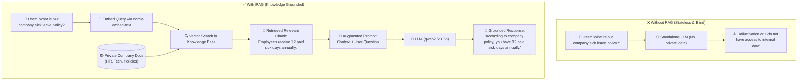

<div align="center">

# 📚 Advanced AI Engineering Journal: RAG & Knowledge Agents
### *Retrieval-Augmented Generation, Vector Databases & Semantic Architecture*

[](https://www.python.org/)
[](https://ollama.com/)
[](https://huggingface.co/Qwen/Qwen2.5-1.5B)
[-7C4DFF?style=for-the-badge&logo=matrix&logoColor=white)](https://ollama.com/library/nomic-embed-text)
[](#)

---

*This journal documents the second stage of our AI Engineering journey starting from **Module 13**, covering Retrieval-Augmented Generation (RAG), high-dimensional vector embeddings, semantic search, document chunking, and knowledge-grounded autonomous agents.*

*For foundational agent architecture (Modules 1–12: Memory, System Prompts, Tool Calling, Chained Loops, Refactoring & Streaming), refer to the [Foundation Logbook](Foundation/LOGBOOK.md).*

</div>

<br />

---

## 🗺️ Curriculum Progression Roadmap

```text
┌──────────────────────────────────────────────────────────┐
│  STAGE 1: FOUNDATION (Modules 1–12)                      │  ✅ COMPLETED
│  - Local LLM Setup & OpenAI-Compatible REST Protocol     │  See: notes/Foundation/LOGBOOK.md
│  - Conversational Memory & Context Accumulation          │
│  - System Prompt Personas (The RCTEF Framework)          │
│  - Function Calling & JSON Schema Mapping                │
│  - Chained Agent Loops (Bounded Multi-Step Reasoning)    │
│  - Modular Refactoring & ANSI Colored Debug Logging      │
│  - Real-Time Token Streaming & Safe Interrupts (SIGINT)  │
└──────────────────────────────────────────────────────────┘
                            │
                            ▼
┌──────────────────────────────────────────────────────────┐
│  STAGE 2: RAG & KNOWLEDGE AGENTS (Module 13 Onwards)     │  🚀 ACTIVE TRACK
│  - Vector Embeddings & High-Dimensional Semantic Spaces  │  📍 Module 13 (Current)
│  - Cosine Similarity & Vector Mathematics (NumPy)        │  📍 Module 13 (Current)
│  - Document Parsing & Intelligent Chunking Strategies    │  ⏳ Module 14+
│  - Local Vector Stores & Similarity Indexing             │  ⏳ Module 14+
│  - End-to-End RAG Pipelines & Knowledge Tool Integration │  ⏳ Module 14+
└──────────────────────────────────────────────────────────┘
```

---

## 🚀 [Phase 9] - Introduction to RAG, Vector Embeddings & Semantic Search

<div align="center">

[](#)
[](#)
[](#)
[](#)
[](#)

</div>

> **Milestone Focus:** Module 13 — *RAG Fundamentals, Vector Embeddings & Semantic Search*  
> **Status:** `COMPLETED`  
> **Prerequisites:** [Foundation: Modules 1–12](Foundation/LOGBOOK.md)  
> **Hardware Profile:** Intel Core i3 (CPU Inference, Local Ollama, 0 API Cost)  
> **Active Models:** `qwen2.5:1.5b` (Chat Generation) + `nomic-embed-text` (Vector Embeddings, 768 dimensions)  

---

### 1. 🎯 Learning Objectives & Context

- **The Enterprise Limitation:** Understand why standalone Large Language Models cannot answer questions about private, proprietary, or post-cutoff organization data (e.g., internal company leave policies, medical plans, tech specs).
- **The Failure of Retraining:** Recognize why fine-tuning or re-training LLMs on private documents is slow, prohibitively expensive, and mathematically prone to hallucinations.
- **The RAG Solution:** Master the core architecture of **Retrieval-Augmented Generation (RAG)**: searching an external knowledge base for relevant context, injecting that context into the prompt, and letting the model synthesize grounded, factual answers.
- **Vector Embeddings & Semantic Search:** Move beyond rigid keyword matching to semantic search by converting text into high-dimensional vectors (768 numbers) where semantically similar concepts cluster together.
- **Vector Math via Cosine Similarity:** Calculate the directional alignment between text vectors using **Cosine Similarity** powered by Python's `numpy` library.
- **The Inviolable Embedding Law:** Learn why the query and the knowledge base **must** be embedded using the exact same embedding model.

---

### 2. 🧠 The Feynman Intuition (Explain Like I'm 12)

> [!NOTE]
> **Metaphor 1: The Closed-Book vs. Open-Book Exam 📖**
> 
> - **The Standalone LLM (Closed-Book Exam):** Imagine a very smart student taking a final exam locked in a room without books or notes. They only know what they memorized months ago during training. If you ask them, *"What is the leave policy of ACME Corp in 2026?"*, they have never seen your company's handbook! If forced to answer, they will either say *"I don't know"* or confidently guess (hallucinate).
> - **The Retraining Approach (Brain Surgery):** To teach the student your company's handbook, you perform complex, multi-million-dollar brain surgery (re-training the model). It takes weeks, costs a fortune, and might cause the student to forget how to code Python!
> - **RAG (The Open-Book Exam):** Instead of brain surgery, you hand the student an open binder of your company's documents. When a question is asked, a research assistant flips through the binder, finds the exact 2 paragraphs about leave policy, and paperclips them to the exam sheet. The student simply reads those 2 paragraphs and writes down the perfect answer! **That is RAG: Retrieve the facts, Augment the prompt, Generate the answer.**

---

> [!NOTE]
> **Metaphor 2: The Semantic GPS Coordinates 📍**
> 
> How does a computer know that `"car"` and `"automobile"` mean almost the exact same thing, while `"banana"` is completely unrelated?
> 
> Words have no intrinsic math. But an **Embedding Model** translates words into **GPS coordinates in a 768-dimensional space**:
> - `"car"` $\rightarrow$ `[0.82, 0.10, 0.45, ...]`
> - `"automobile"` $\rightarrow$ `[0.79, 0.14, 0.48, ...]` (Almost identical coordinates!)
> - `"banana"` $\rightarrow$ `[-0.12, 0.71, -0.80, ...]` (Way off in another galaxy!)
> 
> When a user searches for *"days off"*, the computer doesn't search for the literal letters `d-a-y-s`. It looks at the GPS coordinate of *"days off"* and finds the document chunk with the closest coordinates: *"vacation policy"*!

---

### 3. 🗺️ Visual Architecture & Execution Flow

#### A. Standalone LLM vs. Retrieval-Augmented Generation (RAG)



---

#### B. Geometric Vector Angle & Cosine Similarity

In a high-dimensional vector space, two vectors that point in the same direction have an angle $\theta \approx 0^\circ$, meaning their **Cosine Similarity** ($\cos\theta$) is close to **$1.0$**. Unrelated concepts sit perpendicular ($\theta \approx 90^\circ$, $\cos\theta \approx 0.0$).

```text
               Y-Axis (Concepts)
                   ▲
                   │               Text 2: "Python is used for AI code"
                   │              ↗ (emb_2)
                   │             /  
                   │            / ) θ ≈ 0° -> cos(θ) ≈ 0.73 (HIGH SIMILARITY!)
                   │           /
                   │          ┌──────────────────► Text 1: "Python is a programming language"
                   │                                (emb_1)
                   │
                   │   Text 3: "I love eating apples every morning"
                   │  ▲ (emb_3)
                   │  │ 
                   │  │ ) θ ≈ 90° -> cos(θ) ≈ 0.35 (LOW SIMILARITY / UNRELATED)
                   │  │
                   └──────────────────────────────────────► X-Axis
```

---

### 4. 🔍 Step-by-Step Concept Breakdown (In Exact Lecture Order)

#### A. Why Do We Even Need RAG?
Until now, our AI assistant drew information from only two sources:
1. **Pre-Trained Knowledge:** Facts the LLM learned during training (cutoff at a fixed point in time; zero knowledge of internal company data).
2. **Deterministic Tools:** External functions we hand-wrote (e.g. `get_current_time()`, `get_city_weather()`).

If you deploy this agent inside an enterprise (e.g., an IT company, a hospital, or a legal firm):
- The company has thousands of internal documents: HR policies, medical guidelines, architectural diagrams, post-mortems, and customer FAQs.
- The base LLM knows **nothing** about these internal documents.

```text
The Question: "How many sick leaves am I allowed in my company?"
The LLM's Dilemma:
  ├── Scenario A: "I don't know your company's internal rules." (Unhelpful)
  └── Scenario B: "You get 20 sick leaves!" (Dangerous Hallucination)
```

---

#### B. Why Not Just Retrain or Fine-Tune the Model?
Many beginners ask: *"Why not just train the LLM on our company documents?"*

| Dimension | ❌ Retraining / Fine-Tuning | ✅ Retrieval-Augmented Generation (RAG) |
| :--- | :--- | :--- |
| **Financial Cost** | High (Thousands of dollars in GPU compute) | **Zero to minimal** (Runs locally on CPU) |
| **Update Speed** | Very slow (Hours or days of training) | **Instant** (Add a new document in milliseconds) |
| **Hallucination Risk** | High (Weights can invent or blend facts) | **Near zero** (Grounded directly on retrieved source text) |
| **Data Privacy** | Sensitive data permanently baked into weights | **Strict Access Control** (Filter chunks by user role) |
| **Citation Ability** | Cannot cite exact file names or page numbers | **Full Provenance** (Shows source document, page, and chunk) |

---

#### C. The Failure of Keyword Search & The Need for Semantic Search
Why can't we simply use `string.find()` or SQL `LIKE '%sick leave%'`?
Because human beings express the exact same meaning using completely different words:
- User A: *"How many **sick leaves** are allowed?"*
- User B: *"How many **days off** do I get if I catch the flu?"*
- User C: *"What is the **medical leave entitlement**?"*
- User D: *"What is the **illness absence policy**?"*

If the HR document uses the phrase `"Medical Absence Allowance"`, a keyword search fails completely!
We need **Semantic Search**: a search system that understands the underlying *meaning* of the question regardless of the specific vocabulary used.

---

#### D. What are Vector Embeddings?
An **Embedding** is a mathematical bridge that turns human language into a list of floating-point numbers (a vector) that captures semantic relationships.

```text
Raw Text: "Python is a programming language"
    │
    ▼ Tokenization (Splits text into sub-word tokens)
Tokens: ["Python", " is", " a", " programming", " language"]
    │
    ▼ Vocabulary Lookup
Token IDs: [19234, 318, 257, 12431, 3303]
    │
    ▼ Embedding Model Ingestion & Pooling
Vector: [0.0204, 0.0272, -0.1090, -0.0222, ..., 0.0365]  <-- 768 Float Numbers!
```

**Key Mathematical Characteristic:**
Concepts with similar semantic meanings produce vectors that sit close together in vector space:
- $\text{Embedding}(\text{"car"})$ is nearly identical to $\text{Embedding}(\text{"automobile"})$.
- $\text{Embedding}(\text{"banana"})$ points in a completely different direction.

---

#### E. Understanding Model Naming Conventions
In the open-source AI ecosystem (HuggingFace & Ollama), model names follow a standard taxonomy:

```text
        nomic  -  embed  -  text  :  latest
        ─────     ─────     ────     ──────
          │         │         │        │
      Provider    Task   Modality   Version
      (Family)    Type   (Base)
```

1. **Provider / Family (`nomic`):** The research team or company that created the model (e.g., Nomic AI, BAAI, Snowflake).
2. **Task Type (`embed`):** Indicates the model does not generate chat responses; it produces high-dimensional embeddings.
3. **Modality (`text`):** Ingests text inputs (as opposed to vision/multimodal models that embed images or audio).
4. **Version Tag (`latest`):** The release build.
5. **Dimensions:** By default, `nomic-embed-text` outputs vectors with **768 dimensions**.

---

#### F. What is "Pooling"? (Token Embeddings $\rightarrow$ Sentence Vector)
When an embedding model processes a sentence, it initially computes a separate vector for *every single token*.
To represent the **entire sentence** as a single vector, the model combines the individual token vectors through a mathematical process called **Pooling**:
- **Mean Pooling (Average):** Averages all token vectors across each dimension.
- **CLS Pooling:** Uses the special `[CLS]` (classification) token vector at the start of the sentence.

> [!NOTE]
> The final output of the embedding pipeline is always a single, unified 768-dimensional vector representing the semantic essence of the entire input passage.

---

#### G. Vector Mathematics: How Cosine Similarity Works
To compare two embedding vectors $\mathbf{A}$ and $\mathbf{B}$, we do not look at their lengths; we measure the **angle $\theta$ between their directional arrows**:

$$\text{Cosine Similarity} = \cos(\theta) = \frac{\mathbf{A} \cdot \mathbf{B}}{\|\mathbf{A}\| \|\mathbf{B}\|}$$

Where:
- $\mathbf{A} \cdot \mathbf{B}$ is the **Dot Product**: $\sum_{i=1}^{n} A_i B_i = (A_1 B_1 + A_2 B_2 + \dots + A_n B_n)$
- $\|\mathbf{A}\|$ is the **Magnitude (L2 Norm)**: $\sqrt{\sum_{i=1}^{n} A_i^2}$
- $\|\mathbf{B}\|$ is the **Magnitude (L2 Norm)**: $\sqrt{\sum_{i=1}^{n} B_i^2}$

```text
Cosine Similarity Value Spectrum:
┌──────────────┬───────────────────────────────┬──────────────────────────────────────────┐
│ Score Value  │ Angle (θ)                     │ Semantic Meaning                         │
├──────────────┼───────────────────────────────┼──────────────────────────────────────────┤
│ Close to 1.0 │ θ ≈ 0° (Parallel arrows)      │ Identical or highly related concepts     │
│ Around 0.0   │ θ ≈ 90° (Perpendicular)      │ Completely unrelated concepts            │
│ Close to -1.0│ θ ≈ 180° (Opposite arrows)    │ Diametrically opposite meanings (Rare)   │
└──────────────┴───────────────────────────────┴──────────────────────────────────────────┘
```

---

#### H. Why NumPy is the Standard in AI Engineering
Writing pure Python loops for 768-dimensional dot products is slow. **NumPy** (`Numerical Python`) executes vector calculations in optimized C/Fortran:
1. **Dot Product:** `np.dot(a, b)`
2. **Vector Length (L2 Norm):** `np.linalg.norm(a)`
3. **Cosine Similarity Function:**
```python
def cosine_similarity(a, b):
    return np.dot(a, b) / (np.linalg.norm(a) * np.linalg.norm(b))
```

---

#### I. ⚠️ The Inviolable Golden Rule of RAG: Model Symmetry!

> [!CAUTION]
> **Never Mix Embedding Models!**
> 
> An embedding vector is meaningful **only within the mathematical space of the specific model that generated it**.
> 
> - If you embed your company's documents using `nomic-embed-text` (Space A)...
> - You **CANNOT** embed the user's query using OpenAI's `text-embedding-3-small` or BAAI's `bge-small` (Space B)!
> - Comparing vectors across different models is like taking longitude/latitude from Earth and comparing them to coordinates on Mars. The numbers will be complete nonsense!
> 
> **Consequence:** If you ever upgrade or change your embedding model in production, you **must re-embed your entire document knowledge base** using the new model.

---

### 5. 💻 Code Walkthrough & Line-by-Line Anatomy

#### A. Generating Vector Embeddings (`code_snippets/test_embedding.py`)

[code_snippets/test_embedding.py](file:///c:/Users/Vikash%20Tiwari/Desktop/Documents/Abhishek%20Tiwari/2028/ai-agent-scratch/code_snippets/test_embedding.py)

```python
import os
from dotenv import load_dotenv
from openai import OpenAI

load_dotenv()

# Initialize OpenAI-compatible local client pointing to Ollama
client = OpenAI(
    base_url=os.getenv("BASE_URL"),
    api_key=os.getenv("API_KEY")
)

EMBED_MODEL = os.getenv("EMBED_MODEL", "nomic-embed-text")

# Single input embedding generation
response = client.embeddings.create(
    model=EMBED_MODEL,
    input="I am a good person"
)

# Extract 768-dimensional float list
embedding_vector = response.data[0].embedding
print(f"Dimensions: {len(embedding_vector)}")
print(f"First 5 floats: {embedding_vector[:5]}")
```

#### 🔍 Anatomy Breakdown:
- **`client.embeddings.create(...)`:** Calls Ollama's OpenAI-compatible embedding endpoint (`/v1/embeddings`).
- **`input` Parameter:** Accepts either a single string (`"I am a good person"`) or a batch list of strings (`["Text 1", "Text 2"]`).
- **`response.data`:** Returns a list of embedding objects. Each object contains an `embedding` field holding the raw vector.
- **`len(embedding_vector)`:** Consistently returns **768** float values for every input string.

---

#### B. Semantic Search & Cosine Similarity (`code_snippets/semantic_search_test.py`)

[code_snippets/semantic_search_test.py](file:///c:/Users/Vikash%20Tiwari/Desktop/Documents/Abhishek%20Tiwari/2028/ai-agent-scratch/code_snippets/semantic_search_test.py)

```python
import os
from dotenv import load_dotenv
import numpy as np
from openai import OpenAI

load_dotenv()
client = OpenAI(base_url=os.getenv("BASE_URL"), api_key=os.getenv("API_KEY"))
EMBED_MODEL = os.getenv("EMBED_MODEL", "nomic-embed-text")

def get_embedding(text: str):
    """Generates 768-dimensional embedding vector for a given text."""
    response = client.embeddings.create(model=EMBED_MODEL, input=text)
    return response.data[0].embedding

def cosine_similarity(a, b):
    """Calculates cosine similarity: (A . B) / (||A|| * ||B||)"""
    dot_product = np.dot(a, b)
    norm_a = np.linalg.norm(a)
    norm_b = np.linalg.norm(b)
    return dot_product / (norm_a * norm_b)

text_1 = "Python is a programming language."
text_2 = "Python is used to write AI related code snippets."
text_3 = "I love eating apples every morning."

emb_1 = get_embedding(text_1)
emb_2 = get_embedding(text_2)
emb_3 = get_embedding(text_3)

sim_1_2 = cosine_similarity(emb_1, emb_2)
sim_1_3 = cosine_similarity(emb_1, emb_3)

print(f"Similarity (Text 1 <-> Text 2): {sim_1_2:.2f}")  # Output: 0.73
print(f"Similarity (Text 1 <-> Text 3): {sim_1_3:.2f}")  # Output: 0.35
```

#### 🔍 Anatomy Breakdown:
- **`np.dot(a, b)`:** Computes vector dot product in compiled C.
- **`np.linalg.norm(a)`:** Calculates Euclidean magnitude $\sqrt{\sum a_i^2}$.
- **`sim_1_2 (0.73)`:** Captures strong semantic proximity between programming and AI coding.
- **`sim_1_3 (0.35)`:** Low score reflects semantic divergence between eating fruit and programming languages.

---

### 6. 🧩 Before vs. After Code Evolution Matrix

| Engineering Dimension | Foundation Track (Modules 1–12) | RAG Track (Module 13 Onwards) | Architectural Impact |
| :--- | :--- | :--- | :--- |
| **Model Scope** | Chat completion model only (`qwen2.5:1.5b`) | Dual models: Chat model + Dedicated Embedding model (`nomic-embed-text`) | Separates text generation from semantic representation. |
| **Knowledge Boundary** | Model pre-training weights + manual tools | Dynamic, private external knowledge base (documents, files, policies) | Enables enterprise deployment without hallucinations. |
| **Search Mechanism** | None (LLM relies solely on in-context prompts) | High-dimensional vector search via Cosine Similarity | Resolves intent and meaning across varied vocabularies. |
| **Dependencies** | `openai`, `python-dotenv`, `requests` | Added `numpy` for high-speed linear algebra | Sub-millisecond vector math on CPU hardware. |
| **Data Format** | Plain text / chat messages | 768-dimensional float arrays (`List[float]`) | Compact, mathematical storage of semantic concepts. |

---

### 7. 🏆 The 3 Golden Takeaways

1. **Context Augmentation Beats Model Retraining:** Retraining an LLM to inject proprietary enterprise knowledge is slow, astronomically expensive, and causes catastrophic forgetting. RAG gives the model an open book at query time with zero training costs.
2. **Vectors Capture Concepts, Not Characters:** Keyword search breaks when users vary their phrasing. Vector embeddings map text into continuous conceptual spaces where `"vacation"`, `"leave"`, and `"day off"` live right next to each other.
3. **Model Symmetry is Strictly Inviolable:** The query embedding model and document embedding model must be identical. Swapping or mismatching embedding models renders all stored similarity calculations mathematically meaningless.

---

### 8. ⚠️ Common Traps & Real-World Gotchas

1. **The Embedding Model Mismatch Trap:**  
   - *Problem:* A developer embeds company documents with `nomic-embed-text` but embeds the user's query with `bge-small` or OpenAI's API.  
   - *Symptom:* Cosine similarities hover near zero or return totally random, incorrect documents.  
   - *Fix:* Centralize the embedding model name in `.env` (`EMBED_MODEL`) and ensure all ingestion and search pipelines reference the same configuration.

2. **The Zero-Vector Division Trap:**  
   - *Problem:* If an input string produces a zero vector (or norm is 0), dividing by `norm_a * norm_b` throws `ZeroDivisionError` or produces `NaN`.  
   - *Fix:* Guard the denominator: `denom = norm_a * norm_b; return dot / denom if denom > 0 else 0.0`.

3. **Thinking Embeddings Generate Text:**  
   - *Misconception:* Beginners often try to call `.create()` on an embedding model expecting a conversational answer.  
   - *Reality:* Embedding models have no generative decoder head. They strictly map input text into a numeric float vector. Text generation is handled exclusively by the chat LLM.

---

### 9. 🎓 Technical Interview Flashcards

**Q1: Why is RAG preferred over Fine-Tuning for private knowledge retrieval?**  
> **Answer:** Fine-tuning updates model weights, which is computationally expensive, slow to update, cannot guarantee 100% factual accuracy (hallucinations persist), and cannot provide verifiable citations. RAG separates knowledge storage from reasoning: private data lives in an easily updated vector database, and the model acts as a reasoning engine over dynamically retrieved context.

**Q2: What is the mathematical difference between Dot Product and Cosine Similarity?**  
> **Answer:** The Dot Product measures both direction and vector magnitude ($A \cdot B = \|A\| \|B\| \cos\theta$). Cosine Similarity normalizes the dot product by dividing by the product of both vector lengths ($\frac{A \cdot B}{\|A\| \|B\|}$), making the score solely dependent on the angle $\theta$ between vectors and completely invariant to document length.

**Q3: What is "Pooling" in transformer-based embedding models?**  
> **Answer:** Transformers output an embedding vector for every individual token in the input sequence. Pooling is the aggregation strategy (such as Mean Pooling across all tokens or taking the `[CLS]` token representation) used to compress the multi-token matrix into a single fixed-length vector representing the entire text passage.

**Q4: What happens if an organization upgrades its embedding model?**  
> **Answer:** Because vector coordinates are specific to the latent space learned by a particular model architecture during training, any change in embedding model invalidates all existing vector embeddings. The organization must re-embed all documents in its vector database using the new model.

---

### 10. 🧪 Live Verification & Test Matrix

Tested on local **Intel Core i3** using local Ollama server:

| Test Script | Inputs Tested | Dimensions & Raw Metric | Observed Semantic Result | Status |
| :--- | :--- | :--- | :--- | :---: |
| [`test_embedding.py`](file:///c:/Users/Vikash%20Tiwari/Desktop/Documents/Abhishek%20Tiwari/2028/ai-agent-scratch/code_snippets/test_embedding.py) | Single String: `"I am a good person"` | 768 dimensions<br>`[0.0205, 0.0272, -0.1091, ...]` | Generated valid float vector in ~450ms on local CPU. | ✅ **PASS** |
| [`test_embedding.py`](file:///c:/Users/Vikash%20Tiwari/Desktop/Documents/Abhishek%20Tiwari/2028/ai-agent-scratch/code_snippets/test_embedding.py) | Batch Strings: 3 inputs | 3 vectors $\times$ 768 dimensions | Batch endpoint returned separate vectors for all 3 inputs simultaneously. | ✅ **PASS** |
| [`semantic_search_test.py`](file:///c:/Users/Vikash%20Tiwari/Desktop/Documents/Abhishek%20Tiwari/2028/ai-agent-scratch/code_snippets/semantic_search_test.py) | Text 1 (Python) vs. Text 2 (AI Coding) | Cosine Sim: **`0.73`** (Raw: `0.7319`) | High similarity score confirms strong conceptual relationship. | ✅ **PASS** |
| [`semantic_search_test.py`](file:///c:/Users/Vikash%20Tiwari/Desktop/Documents/Abhishek%20Tiwari/2028/ai-agent-scratch/code_snippets/semantic_search_test.py) | Text 1 (Python) vs. Text 3 (Eating Apples) | Cosine Sim: **`0.35`** (Raw: `0.3538`) | Low similarity score clearly distinguishes unrelated topics. | ✅ **PASS** |

---
