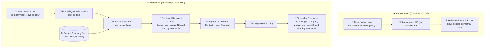
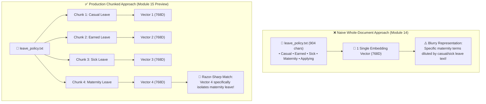
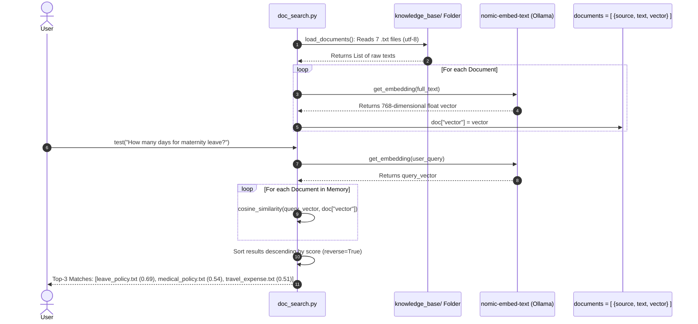
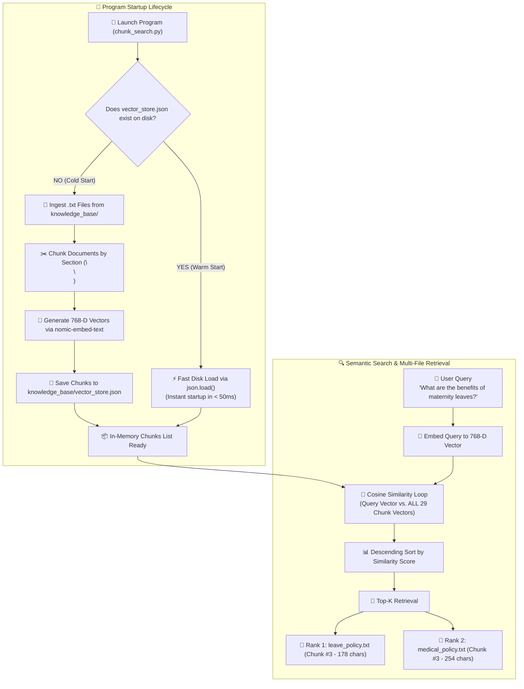
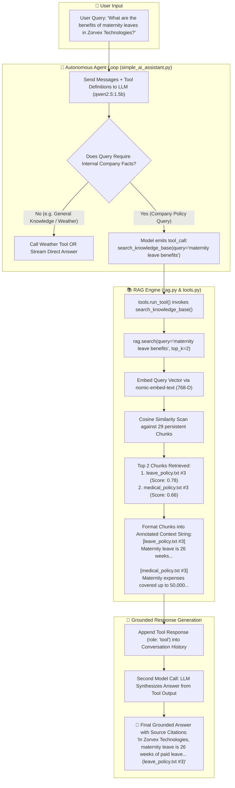

<div align="center">

# 📚 Advanced AI Engineering Journal: RAG & Knowledge Agents
### *Retrieval-Augmented Generation, Vector Databases & Semantic Architecture*

[](https://www.python.org/)
[](https://ollama.com/)
[](https://huggingface.co/Qwen/Qwen2.5-1.5B)
[-7C4DFF?style=for-the-badge&logo=matrix&logoColor=white)](https://ollama.com/library/nomic-embed-text)
[](#)

---

*This journal documents the second stage of our AI Engineering journey starting from **Module 13**, covering Retrieval-Augmented Generation (RAG), high-dimensional vector embeddings, semantic search, document chunking, and knowledge-grounded autonomous agents.*

*For foundational agent architecture (Modules 1–12: Memory, System Prompts, Tool Calling, Chained Loops, Refactoring & Streaming), refer to the [Foundation Logbook](Foundation/LOGBOOK.md).*

</div>

<br />

---

## 🗺️ Curriculum Progression Roadmap

```text
┌──────────────────────────────────────────────────────────┐
│  STAGE 1: FOUNDATION (Modules 1–12)                      │  ✅ COMPLETED
│  - Local LLM Setup & OpenAI-Compatible REST Protocol     │  See: notes/Foundation/LOGBOOK.md
│  - Conversational Memory & Context Accumulation          │
│  - System Prompt Personas (The RCTEF Framework)          │
│  - Function Calling & JSON Schema Mapping                │
│  - Chained Agent Loops (Bounded Multi-Step Reasoning)    │
│  - Modular Refactoring & ANSI Colored Debug Logging      │
│  - Real-Time Token Streaming & Safe Interrupts (SIGINT)  │
└──────────────────────────────────────────────────────────┘
                            │
                            ▼
┌──────────────────────────────────────────────────────────┐
│  STAGE 2: RAG & KNOWLEDGE AGENTS (Module 13 Onwards)     │  🚀 ACTIVE TRACK
│  - Vector Embeddings & High-Dimensional Semantic Spaces  │  ✅ Module 13
│  - Cosine Similarity & Vector Mathematics (NumPy)        │  ✅ Module 13
│  - Knowledge Base Construction & Document-Level Search   │  ✅ Module 14
│  - The 4 Failures of Unchunked RAG & Why Chunking Matters│  ✅ Module 14
│  - Intelligent Document Chunking (Section-Level Splitting)│  ✅ Module 15
│  - Local Vector Store Persistence (vector_store.json)    │  ✅ Module 15
│  - Agentic RAG: Tool-Based Retrieval & Source Citations  │  📍 Module 16 (Current)
│  - Enterprise Scale & Vector Database Architecture       │  ⏳ Module 17+
└──────────────────────────────────────────────────────────┘
```

---

## 🚀 [Phase 9] - Introduction to RAG, Vector Embeddings & Semantic Search

<div align="center">

[](#)
[](#)
[](#)
[](#)
[](#)

</div>

> **Milestone Focus:** Module 13 — *RAG Fundamentals, Vector Embeddings & Semantic Search*  
> **Status:** `COMPLETED`  
> **Prerequisites:** [Foundation: Modules 1–12](Foundation/LOGBOOK.md)  
> **Hardware Profile:** Intel Core i3 (CPU Inference, Local Ollama, 0 API Cost)  
> **Active Models:** `qwen2.5:1.5b` (Chat Generation) + `nomic-embed-text` (Vector Embeddings, 768 dimensions)  

---

### 1. 🎯 Learning Objectives & Context

- **The Enterprise Limitation:** Understand why standalone Large Language Models cannot answer questions about private, proprietary, or post-cutoff organization data (e.g., internal company leave policies, medical plans, tech specs).
- **The Failure of Retraining:** Recognize why fine-tuning or re-training LLMs on private documents is slow, prohibitively expensive, and mathematically prone to hallucinations.
- **The RAG Solution:** Master the core architecture of **Retrieval-Augmented Generation (RAG)**: searching an external knowledge base for relevant context, injecting that context into the prompt, and letting the model synthesize grounded, factual answers.
- **Vector Embeddings & Semantic Search:** Move beyond rigid keyword matching to semantic search by converting text into high-dimensional vectors (768 numbers) where semantically similar concepts cluster together.
- **Vector Math via Cosine Similarity:** Calculate the directional alignment between text vectors using **Cosine Similarity** powered by Python's `numpy` library.
- **The Inviolable Embedding Law:** Learn why the query and the knowledge base **must** be embedded using the exact same embedding model.

---

### 2. 🧠 The Feynman Intuition (Explain Like I'm 12)

> [!NOTE]
> **Metaphor 1: The Closed-Book vs. Open-Book Exam 📖**
> 
> - **The Standalone LLM (Closed-Book Exam):** Imagine a very smart student taking a final exam locked in a room without books or notes. They only know what they memorized months ago during training. If you ask them, *"What is the leave policy of ACME Corp in 2026?"*, they have never seen your company's handbook! If forced to answer, they will either say *"I don't know"* or confidently guess (hallucinate).
> - **The Retraining Approach (Brain Surgery):** To teach the student your company's handbook, you perform complex, multi-million-dollar brain surgery (re-training the model). It takes weeks, costs a fortune, and might cause the student to forget how to code Python!
> - **RAG (The Open-Book Exam):** Instead of brain surgery, you hand the student an open binder of your company's documents. When a question is asked, a research assistant flips through the binder, finds the exact 2 paragraphs about leave policy, and paperclips them to the exam sheet. The student simply reads those 2 paragraphs and writes down the perfect answer! **That is RAG: Retrieve the facts, Augment the prompt, Generate the answer.**

---

> [!NOTE]
> **Metaphor 2: The Semantic GPS Coordinates 📍**
> 
> How does a computer know that `"car"` and `"automobile"` mean almost the exact same thing, while `"banana"` is completely unrelated?
> 
> Words have no intrinsic math. But an **Embedding Model** translates words into **GPS coordinates in a 768-dimensional space**:
> - `"car"` $\rightarrow$ `[0.82, 0.10, 0.45, ...]`
> - `"automobile"` $\rightarrow$ `[0.79, 0.14, 0.48, ...]` (Almost identical coordinates!)
> - `"banana"` $\rightarrow$ `[-0.12, 0.71, -0.80, ...]` (Way off in another galaxy!)
> 
> When a user searches for *"days off"*, the computer doesn't search for the literal letters `d-a-y-s`. It looks at the GPS coordinate of *"days off"* and finds the document chunk with the closest coordinates: *"vacation policy"*!

---

### 3. 🗺️ Visual Architecture & Execution Flow

#### A. Standalone LLM vs. Retrieval-Augmented Generation (RAG)



---

#### B. Geometric Vector Angle & Cosine Similarity

In a high-dimensional vector space, two vectors that point in the same direction have an angle $\theta \approx 0^\circ$, meaning their **Cosine Similarity** ($\cos\theta$) is close to **$1.0$**. Unrelated concepts sit perpendicular ($\theta \approx 90^\circ$, $\cos\theta \approx 0.0$).

```text
               Y-Axis (Concepts)
                   ▲
                   │               Text 2: "Python is used for AI code"
                   │              ↗ (emb_2)
                   │             /  
                   │            / ) θ ≈ 0° -> cos(θ) ≈ 0.73 (HIGH SIMILARITY!)
                   │           /
                   │          ┌──────────────────► Text 1: "Python is a programming language"
                   │                                (emb_1)
                   │
                   │   Text 3: "I love eating apples every morning"
                   │  ▲ (emb_3)
                   │  │ 
                   │  │ ) θ ≈ 90° -> cos(θ) ≈ 0.35 (LOW SIMILARITY / UNRELATED)
                   │  │
                   └──────────────────────────────────────► X-Axis
```

---

### 4. 🔍 Step-by-Step Concept Breakdown (In Exact Lecture Order)

#### A. Why Do We Even Need RAG?
Until now, our AI assistant drew information from only two sources:
1. **Pre-Trained Knowledge:** Facts the LLM learned during training (cutoff at a fixed point in time; zero knowledge of internal company data).
2. **Deterministic Tools:** External functions we hand-wrote (e.g. `get_current_time()`, `get_city_weather()`).

If you deploy this agent inside an enterprise (e.g., an IT company, a hospital, or a legal firm):
- The company has thousands of internal documents: HR policies, medical guidelines, architectural diagrams, post-mortems, and customer FAQs.
- The base LLM knows **nothing** about these internal documents.

```text
The Question: "How many sick leaves am I allowed in my company?"
The LLM's Dilemma:
  ├── Scenario A: "I don't know your company's internal rules." (Unhelpful)
  └── Scenario B: "You get 20 sick leaves!" (Dangerous Hallucination)
```

---

#### B. Why Not Just Retrain or Fine-Tune the Model?
Many beginners ask: *"Why not just train the LLM on our company documents?"*

| Dimension | ❌ Retraining / Fine-Tuning | ✅ Retrieval-Augmented Generation (RAG) |
| :--- | :--- | :--- |
| **Financial Cost** | High (Thousands of dollars in GPU compute) | **Zero to minimal** (Runs locally on CPU) |
| **Update Speed** | Very slow (Hours or days of training) | **Instant** (Add a new document in milliseconds) |
| **Hallucination Risk** | High (Weights can invent or blend facts) | **Near zero** (Grounded directly on retrieved source text) |
| **Data Privacy** | Sensitive data permanently baked into weights | **Strict Access Control** (Filter chunks by user role) |
| **Citation Ability** | Cannot cite exact file names or page numbers | **Full Provenance** (Shows source document, page, and chunk) |

---

#### C. The Failure of Keyword Search & The Need for Semantic Search
Why can't we simply use `string.find()` or SQL `LIKE '%sick leave%'`?
Because human beings express the exact same meaning using completely different words:
- User A: *"How many **sick leaves** are allowed?"*
- User B: *"How many **days off** do I get if I catch the flu?"*
- User C: *"What is the **medical leave entitlement**?"*
- User D: *"What is the **illness absence policy**?"*

If the HR document uses the phrase `"Medical Absence Allowance"`, a keyword search fails completely!
We need **Semantic Search**: a search system that understands the underlying *meaning* of the question regardless of the specific vocabulary used.

---

#### D. What are Vector Embeddings?
An **Embedding** is a mathematical bridge that turns human language into a list of floating-point numbers (a vector) that captures semantic relationships.

```text
Raw Text: "Python is a programming language"
    │
    ▼ Tokenization (Splits text into sub-word tokens)
Tokens: ["Python", " is", " a", " programming", " language"]
    │
    ▼ Vocabulary Lookup
Token IDs: [19234, 318, 257, 12431, 3303]
    │
    ▼ Embedding Model Ingestion & Pooling
Vector: [0.0204, 0.0272, -0.1090, -0.0222, ..., 0.0365]  <-- 768 Float Numbers!
```

**Key Mathematical Characteristic:**
Concepts with similar semantic meanings produce vectors that sit close together in vector space:
- $\text{Embedding}(\text{"car"})$ is nearly identical to $\text{Embedding}(\text{"automobile"})$.
- $\text{Embedding}(\text{"banana"})$ points in a completely different direction.

---

#### E. Understanding Model Naming Conventions
In the open-source AI ecosystem (HuggingFace & Ollama), model names follow a standard taxonomy:

```text
        nomic  -  embed  -  text  :  latest
        ─────     ─────     ────     ──────
          │         │         │        │
      Provider    Task   Modality   Version
      (Family)    Type   (Base)
```

1. **Provider / Family (`nomic`):** The research team or company that created the model (e.g., Nomic AI, BAAI, Snowflake).
2. **Task Type (`embed`):** Indicates the model does not generate chat responses; it produces high-dimensional embeddings.
3. **Modality (`text`):** Ingests text inputs (as opposed to vision/multimodal models that embed images or audio).
4. **Version Tag (`latest`):** The release build.
5. **Dimensions:** By default, `nomic-embed-text` outputs vectors with **768 dimensions**.

---

#### F. What is "Pooling"? (Token Embeddings $\rightarrow$ Sentence Vector)
When an embedding model processes a sentence, it initially computes a separate vector for *every single token*.
To represent the **entire sentence** as a single vector, the model combines the individual token vectors through a mathematical process called **Pooling**:
- **Mean Pooling (Average):** Averages all token vectors across each dimension.
- **CLS Pooling:** Uses the special `[CLS]` (classification) token vector at the start of the sentence.

> [!NOTE]
> The final output of the embedding pipeline is always a single, unified 768-dimensional vector representing the semantic essence of the entire input passage.

---

#### G. Vector Mathematics: How Cosine Similarity Works
To compare two embedding vectors $\mathbf{A}$ and $\mathbf{B}$, we do not look at their lengths; we measure the **angle $\theta$ between their directional arrows**:

$$\text{Cosine Similarity} = \cos(\theta) = \frac{\mathbf{A} \cdot \mathbf{B}}{\|\mathbf{A}\| \|\mathbf{B}\|}$$

Where:
- $\mathbf{A} \cdot \mathbf{B}$ is the **Dot Product**: $\sum_{i=1}^{n} A_i B_i = (A_1 B_1 + A_2 B_2 + \dots + A_n B_n)$
- $\|\mathbf{A}\|$ is the **Magnitude (L2 Norm)**: $\sqrt{\sum_{i=1}^{n} A_i^2}$
- $\|\mathbf{B}\|$ is the **Magnitude (L2 Norm)**: $\sqrt{\sum_{i=1}^{n} B_i^2}$

```text
Cosine Similarity Value Spectrum:
┌──────────────┬───────────────────────────────┬──────────────────────────────────────────┐
│ Score Value  │ Angle (θ)                     │ Semantic Meaning                         │
├──────────────┼───────────────────────────────┼──────────────────────────────────────────┤
│ Close to 1.0 │ θ ≈ 0° (Parallel arrows)      │ Identical or highly related concepts     │
│ Around 0.0   │ θ ≈ 90° (Perpendicular)      │ Completely unrelated concepts            │
│ Close to -1.0│ θ ≈ 180° (Opposite arrows)    │ Diametrically opposite meanings (Rare)   │
└──────────────┴───────────────────────────────┴──────────────────────────────────────────┘
```

---

#### H. Why NumPy is the Standard in AI Engineering
Writing pure Python loops for 768-dimensional dot products is slow. **NumPy** (`Numerical Python`) executes vector calculations in optimized C/Fortran:
1. **Dot Product:** `np.dot(a, b)`
2. **Vector Length (L2 Norm):** `np.linalg.norm(a)`
3. **Cosine Similarity Function:**
```python
def cosine_similarity(a, b):
    return np.dot(a, b) / (np.linalg.norm(a) * np.linalg.norm(b))
```

---

#### I. ⚠️ The Inviolable Golden Rule of RAG: Model Symmetry!

> [!CAUTION]
> **Never Mix Embedding Models!**
> 
> An embedding vector is meaningful **only within the mathematical space of the specific model that generated it**.
> 
> - If you embed your company's documents using `nomic-embed-text` (Space A)...
> - You **CANNOT** embed the user's query using OpenAI's `text-embedding-3-small` or BAAI's `bge-small` (Space B)!
> - Comparing vectors across different models is like taking longitude/latitude from Earth and comparing them to coordinates on Mars. The numbers will be complete nonsense!
> 
> **Consequence:** If you ever upgrade or change your embedding model in production, you **must re-embed your entire document knowledge base** using the new model.

---

### 5. 💻 Code Walkthrough & Line-by-Line Anatomy

#### A. Generating Vector Embeddings (`code_snippets/test_embedding.py`)

[code_snippets/test_embedding.py](file:///c:/Users/Vikash%20Tiwari/Desktop/Documents/Abhishek%20Tiwari/2028/ai-agent-scratch/code_snippets/test_embedding.py)

```python
import os
from dotenv import load_dotenv
from openai import OpenAI

load_dotenv()

# Initialize OpenAI-compatible local client pointing to Ollama
client = OpenAI(
    base_url=os.getenv("BASE_URL"),
    api_key=os.getenv("API_KEY")
)

EMBED_MODEL = os.getenv("EMBED_MODEL", "nomic-embed-text")

# Single input embedding generation
response = client.embeddings.create(
    model=EMBED_MODEL,
    input="I am a good person"
)

# Extract 768-dimensional float list
embedding_vector = response.data[0].embedding
print(f"Dimensions: {len(embedding_vector)}")
print(f"First 5 floats: {embedding_vector[:5]}")
```

#### 🔍 Anatomy Breakdown:
- **`client.embeddings.create(...)`:** Calls Ollama's OpenAI-compatible embedding endpoint (`/v1/embeddings`).
- **`input` Parameter:** Accepts either a single string (`"I am a good person"`) or a batch list of strings (`["Text 1", "Text 2"]`).
- **`response.data`:** Returns a list of embedding objects. Each object contains an `embedding` field holding the raw vector.
- **`len(embedding_vector)`:** Consistently returns **768** float values for every input string.

---

#### B. Semantic Search & Cosine Similarity (`code_snippets/semantic_search_test.py`)

[code_snippets/semantic_search_test.py](file:///c:/Users/Vikash%20Tiwari/Desktop/Documents/Abhishek%20Tiwari/2028/ai-agent-scratch/code_snippets/semantic_search_test.py)

```python
import os
from dotenv import load_dotenv
import numpy as np
from openai import OpenAI

load_dotenv()
client = OpenAI(base_url=os.getenv("BASE_URL"), api_key=os.getenv("API_KEY"))
EMBED_MODEL = os.getenv("EMBED_MODEL", "nomic-embed-text")

def get_embedding(text: str):
    """Generates 768-dimensional embedding vector for a given text."""
    response = client.embeddings.create(model=EMBED_MODEL, input=text)
    return response.data[0].embedding

def cosine_similarity(a, b):
    """Calculates cosine similarity: (A . B) / (||A|| * ||B||)"""
    dot_product = np.dot(a, b)
    norm_a = np.linalg.norm(a)
    norm_b = np.linalg.norm(b)
    return dot_product / (norm_a * norm_b)

text_1 = "Python is a programming language."
text_2 = "Python is used to write AI related code snippets."
text_3 = "I love eating apples every morning."

emb_1 = get_embedding(text_1)
emb_2 = get_embedding(text_2)
emb_3 = get_embedding(text_3)

sim_1_2 = cosine_similarity(emb_1, emb_2)
sim_1_3 = cosine_similarity(emb_1, emb_3)

print(f"Similarity (Text 1 <-> Text 2): {sim_1_2:.2f}")  # Output: 0.73
print(f"Similarity (Text 1 <-> Text 3): {sim_1_3:.2f}")  # Output: 0.35
```

#### 🔍 Anatomy Breakdown:
- **`np.dot(a, b)`:** Computes vector dot product in compiled C.
- **`np.linalg.norm(a)`:** Calculates Euclidean magnitude $\sqrt{\sum a_i^2}$.
- **`sim_1_2 (0.73)`:** Captures strong semantic proximity between programming and AI coding.
- **`sim_1_3 (0.35)`:** Low score reflects semantic divergence between eating fruit and programming languages.

---

### 6. 🧩 Before vs. After Code Evolution Matrix

| Engineering Dimension | Foundation Track (Modules 1–12) | RAG Track (Module 13 Onwards) | Architectural Impact |
| :--- | :--- | :--- | :--- |
| **Model Scope** | Chat completion model only (`qwen2.5:1.5b`) | Dual models: Chat model + Dedicated Embedding model (`nomic-embed-text`) | Separates text generation from semantic representation. |
| **Knowledge Boundary** | Model pre-training weights + manual tools | Dynamic, private external knowledge base (documents, files, policies) | Enables enterprise deployment without hallucinations. |
| **Search Mechanism** | None (LLM relies solely on in-context prompts) | High-dimensional vector search via Cosine Similarity | Resolves intent and meaning across varied vocabularies. |
| **Dependencies** | `openai`, `python-dotenv`, `requests` | Added `numpy` for high-speed linear algebra | Sub-millisecond vector math on CPU hardware. |
| **Data Format** | Plain text / chat messages | 768-dimensional float arrays (`List[float]`) | Compact, mathematical storage of semantic concepts. |

---

### 7. 🏆 The 3 Golden Takeaways

1. **Context Augmentation Beats Model Retraining:** Retraining an LLM to inject proprietary enterprise knowledge is slow, astronomically expensive, and causes catastrophic forgetting. RAG gives the model an open book at query time with zero training costs.
2. **Vectors Capture Concepts, Not Characters:** Keyword search breaks when users vary their phrasing. Vector embeddings map text into continuous conceptual spaces where `"vacation"`, `"leave"`, and `"day off"` live right next to each other.
3. **Model Symmetry is Strictly Inviolable:** The query embedding model and document embedding model must be identical. Swapping or mismatching embedding models renders all stored similarity calculations mathematically meaningless.

---

### 8. ⚠️ Common Traps & Real-World Gotchas

1. **The Embedding Model Mismatch Trap:**  
   - *Problem:* A developer embeds company documents with `nomic-embed-text` but embeds the user's query with `bge-small` or OpenAI's API.  
   - *Symptom:* Cosine similarities hover near zero or return totally random, incorrect documents.  
   - *Fix:* Centralize the embedding model name in `.env` (`EMBED_MODEL`) and ensure all ingestion and search pipelines reference the same configuration.

2. **The Zero-Vector Division Trap:**  
   - *Problem:* If an input string produces a zero vector (or norm is 0), dividing by `norm_a * norm_b` throws `ZeroDivisionError` or produces `NaN`.  
   - *Fix:* Guard the denominator: `denom = norm_a * norm_b; return dot / denom if denom > 0 else 0.0`.

3. **Thinking Embeddings Generate Text:**  
   - *Misconception:* Beginners often try to call `.create()` on an embedding model expecting a conversational answer.  
   - *Reality:* Embedding models have no generative decoder head. They strictly map input text into a numeric float vector. Text generation is handled exclusively by the chat LLM.

---

### 9. 🎓 Technical Interview Flashcards

**Q1: Why is RAG preferred over Fine-Tuning for private knowledge retrieval?**  
> **Answer:** Fine-tuning updates model weights, which is computationally expensive, slow to update, cannot guarantee 100% factual accuracy (hallucinations persist), and cannot provide verifiable citations. RAG separates knowledge storage from reasoning: private data lives in an easily updated vector database, and the model acts as a reasoning engine over dynamically retrieved context.

**Q2: What is the mathematical difference between Dot Product and Cosine Similarity?**  
> **Answer:** The Dot Product measures both direction and vector magnitude ($A \cdot B = \|A\| \|B\| \cos\theta$). Cosine Similarity normalizes the dot product by dividing by the product of both vector lengths ($\frac{A \cdot B}{\|A\| \|B\|}$), making the score solely dependent on the angle $\theta$ between vectors and completely invariant to document length.

**Q3: What is "Pooling" in transformer-based embedding models?**  
> **Answer:** Transformers output an embedding vector for every individual token in the input sequence. Pooling is the aggregation strategy (such as Mean Pooling across all tokens or taking the `[CLS]` token representation) used to compress the multi-token matrix into a single fixed-length vector representing the entire text passage.

**Q4: What happens if an organization upgrades its embedding model?**  
> **Answer:** Because vector coordinates are specific to the latent space learned by a particular model architecture during training, any change in embedding model invalidates all existing vector embeddings. The organization must re-embed all documents in its vector database using the new model.

---

### 10. 🧪 Live Verification & Test Matrix

Tested on local **Intel Core i3** using local Ollama server:

| Test Script | Inputs Tested | Dimensions & Raw Metric | Observed Semantic Result | Status |
| :--- | :--- | :--- | :--- | :---: |
| [`test_embedding.py`](file:///c:/Users/Vikash%20Tiwari/Desktop/Documents/Abhishek%20Tiwari/2028/ai-agent-scratch/code_snippets/test_embedding.py) | Single String: `"I am a good person"` | 768 dimensions<br>`[0.0205, 0.0272, -0.1091, ...]` | Generated valid float vector in ~450ms on local CPU. | ✅ **PASS** |
| [`test_embedding.py`](file:///c:/Users/Vikash%20Tiwari/Desktop/Documents/Abhishek%20Tiwari/2028/ai-agent-scratch/code_snippets/test_embedding.py) | Batch Strings: 3 inputs | 3 vectors $\times$ 768 dimensions | Batch endpoint returned separate vectors for all 3 inputs simultaneously. | ✅ **PASS** |
| [`semantic_search_test.py`](file:///c:/Users/Vikash%20Tiwari/Desktop/Documents/Abhishek%20Tiwari/2028/ai-agent-scratch/code_snippets/semantic_search_test.py) | Text 1 (Python) vs. Text 2 (AI Coding) | Cosine Sim: **`0.73`** (Raw: `0.7319`) | High similarity score confirms strong conceptual relationship. | ✅ **PASS** |
| [`semantic_search_test.py`](file:///c:/Users/Vikash%20Tiwari/Desktop/Documents/Abhishek%20Tiwari/2028/ai-agent-scratch/code_snippets/semantic_search_test.py) | Text 1 (Python) vs. Text 3 (Eating Apples) | Cosine Sim: **`0.35`** (Raw: `0.3538`) | Low similarity score clearly distinguishes unrelated topics. | ✅ **PASS** |

---

## 🚀 [Phase 10] - Building a Knowledge Base & Exposing the 4 Limitations of Unchunked RAG

<div align="center">

[](#)
[](#)
[](#)
[](#)
[](#)

</div>

> **Milestone Focus:** Module 14 — *Building Knowledge Base for RAG & The Necessity of Chunking*  
> **Status:** `COMPLETED`  
> **Prerequisites:** [Phase 9: RAG Fundamentals & Semantic Search](RAG_LOGBOOK.md#phase-9---introduction-to-rag-vector-embeddings--semantic-search)  
> **Hardware Profile:** Intel Core i3 (CPU Inference, Local Ollama, 0 API Cost)  
> **Active Models:** `nomic-embed-text` (Vector Embeddings, 768 dimensions)  

---

### 1. 🎯 Learning Objectives & Context

- **The Fundamental Question:** Why don't production RAG systems just embed whole documents as a single vector? What breaks when we do $1 \text{ Document} \rightarrow 1 \text{ Embedding}$?
- **Knowledge Base Construction:** Build a realistic enterprise knowledge base (`knowledge_base/`) containing multi-topic corporate policies (HR, Hiring, Leave, Medical, RCA, Tech, Travel).
- **The Naive Document Search Pipeline:** Implement a complete 4-step in-memory search engine:
  1. `load_documents()`: Safe file system ingestion using standard `utf-8` decoding.
  2. `add_embeddings()`: Whole-document vectorization using `nomic-embed-text`.
  3. `search()`: Top-$K$ semantic similarity ranking via Cosine Similarity and custom Lambda sorting.
  4. `test()`: Real-time query evaluation against private documents.
- **Exposing the 4 Critical Limitations:** Discover from first principles why naive unchunked RAG collapses at enterprise scale:
  1. **The "Blurry Vector" Problem:** Compressing an entire multi-page document into a single vector dilutes specific details.
  2. **In-Memory Ephemeral Storage:** Re-embedding every file on application restart is prohibitively slow ($O(N)$ network/compute overhead).
  3. **Context Window Flooding:** Feeding complete multi-page files into the LLM prompt causes latency spikes, token limit breaches, and model distraction.
  4. **The False-Positive Fallacy:** Unchecked Top-$K$ retrieval always returns documents even for completely irrelevant queries.

---

### 2. 🧠 The Feynman Intuition (Explain Like I'm 12)

> [!NOTE]
> **Metaphor 1: The Blurry Panoramic Photograph 📸**
> 
> Imagine you visit the Grand Canyon. You take a single, ultra-wide panoramic photo of the entire 10-mile horizon. In that single photo, you can see mountains, trees, clouds, rocks, and a tiny eagle sitting on a branch.
> 
> - **The Whole-Document Approach ($1 \text{ File} = 1 \text{ Vector}$):** You compress that massive 10-mile photo into a tiny $1 \times 1$ inch stamp. What happens to the tiny eagle? **It blurs into an unrecognizable dot!** You can tell the stamp is about "nature", but if someone asks, *"Show me the eagle's beak"*, the image is too blurry to see it.
> - **The Chunking Approach:** Instead of one massive blurry stamp, you take crisp, close-up snapshot photos of each individual section: one photo of the eagle, one photo of the campsite, one photo of the river. When someone asks for the eagle, you hand them the exact close-up!
> - **In AI:** An entire 20-page document compressed into 768 float numbers blurs specific facts (like maternity leave days). Breaking it into focused chunks keeps every detail razor-sharp!

---

> [!NOTE]
> **Metaphor 2: Ordering a Full Library Book for One Sentence 📚**
> 
> Suppose you want to know what year George Washington was born.
> 
> - **Naive Unchunked Search:** The librarian brings you a heavy 900-page biography of George Washington, dumps it on your desk, and says: *"Read this whole book to find the year."* Your desk is crowded (Context Window overflow), it takes forever to read (High Latency), and you get distracted by stories about his wooden teeth (LLM distraction).
> - **Chunked Search:** The librarian photocopies **just the 2-sentence paragraph** mentioning his birthdate and hands you a small slip of paper. You get your answer instantly with zero clutter!

---

### 3. 🗺️ Visual Architecture & Execution Flow

#### A. Naive Whole-Document Ingestion vs. Chunked Ingestion



---

#### B. The Complete In-Memory Document Search Pipeline



---

### 4. 🔍 Step-by-Step Concept Breakdown (In Exact Lecture Order)

#### A. The Question Nobody Asks: Why Not 1 Document = 1 Embedding?
Every beginner tutorial says: *"Split text into chunks, then embed."*
Mik pauses and asks the critical first-principles question:
> *"Why do we need to split documents into chunks at all? Why can't we simply take each file, pass its full text to the embedding model, generate one vector per file, and search over that?"*

To discover the answer through evidence rather than dogma, we build the unchunked system first and analyze its behavior.

---

#### B. Building the Enterprise Knowledge Base (`knowledge_base/`)
We constructed a simulated corporate knowledge repository for **Zorvex Technologies** containing 7 distinct business domains:

| File Name | Domain Covered | Key Topics Contained |
| :--- | :--- | :--- |
| `hiring_process.txt` | Recruitment & HR | 5 interview rounds, 7-day offer window, 25,000 INR referral bonus, pre-onboarding checklist. |
| `hr_docs.txt` | Workplace Guidelines | 9:30 AM – 6:30 PM working hours, 2-day hybrid policy, code of conduct, bi-annual reviews. |
| `leave_policy.txt` | Employee Leaves | 12 casual days, 18 earned days (max 30 carry forward), 10 sick days, 26 weeks maternity, 10 days paternity. |
| `medical_policy.txt` | Insurance & Health | 500,000 INR sum insured, cashless hospitalization, maternity cover up to 75,000 INR for C-section. |
| `rca_docs.txt` | Engineering Incidents | P0/P1 post-mortem rules, 24-hour summary, 5-Whys root cause analysis framework. |
| `tech_docs.txt` | Software Architecture | Docker, Kubernetes, 2-reviewer PR rule, `feat/TICKET-ID` Git branches, Grafana/Loki logs. |
| `travel_expense.txt` | Business Travel | Economy flights >4 hours, 4,000 INR hotel cap, 1,200 INR per diem, 15-day claim settlement. |

---

#### C. Step 1: Loading Documents from Disk (`load_documents`)
To ingest the files cleanly into Python:
1. `os.listdir(folder)`: Discovers all files in the directory.
2. `sorted()`: Sorts file names alphabetically for deterministic ordering across operating systems.
3. `filename.endswith(".txt")`: Ignores hidden OS artifacts (e.g. `.DS_Store` on Mac, `Thumbs.db` on Windows).
4. `os.path.join(folder, filename)`: Safely constructs platform-independent paths (`/` vs `\`).
5. **The Encoding Standard (`encoding="utf-8"`):**
   Computers only understand binary bytes (`0`s and `1`s). Different operating systems map bytes to characters using different default code pages (e.g., Windows uses `cp1252`, Linux uses `utf-8`). If a file contains currency symbols (₹, €), smart quotes (“ ”), or emojis, reading without `utf-8` crashes Python with `UnicodeDecodeError`. Specifying `encoding="utf-8"` ensures consistent execution across Windows, Linux, and macOS.
6. **The `with open(...) as f:` Context Manager:**
   Automatically closes the file descriptor when execution exits the block, preventing operating system resource leaks.

---

#### D. Step 2: Full-Document Embedding (`add_embeddings`)
For every document in memory:
```python
vector = get_embedding(document["text"])
document["vector"] = vector
```
Each dictionary now holds:
- `"source"`: File name (e.g., `'leave_policy.txt'`).
- `"text"`: The full document string.
- `"vector"`: A 768-dimensional float array representing the entire document.

---

#### E. Step 3: Top-$K$ Semantic Search (`search`)
1. User query (e.g. *"How many days I will get for maternity leave ?"*) is embedded into a 768-D `query_vector`.
2. Cosine similarity is computed between `query_vector` and every `document["vector"]`.
3. Results are sorted in **descending order** by similarity score using a custom Lambda key:
   ```python
   results.sort(key=lambda rec: rec["score"], reverse=True)
   ```
4. Slice and return the top-$K$ matches (`results[:top_k]`).

---

### 💥 F. The 4 Critical Limitations of Naive Unchunked Search

By testing our naive implementation, we uncovered the 4 reasons why unchunked RAG fails in production:

```text
┌────────────────────────────────────────────────────────────────────────────────────────┐
│               THE 4 FATAL FLAWS OF NAIVE UNCHUNKED DOCUMENT RAG                        │
├──────────────────────────┬─────────────────────────────────────────────────────────────┤
│ 1. Blurry Vectors        │ Compressing 50 pages into 768 floats washes out details.    │
│ 2. Ephemeral Storage     │ In-memory embedding on every restart causes slow boot times.│
│ 3. Context Flooding      │ Sending whole 20-page files causes LLM timeout & distraction│
│ 4. False-Positive Trap   │ Irrelevant queries still return Top-3 garbage matches.       │
└──────────────────────────┴─────────────────────────────────────────────────────────────┘
```

#### 1. Flaw #1: The "Blurry Vector" Problem (Information Loss / Dilution)
- `leave_policy.txt` covers 5 distinct policies: Casual, Earned, Sick, Maternity, and Paternity.
- When all 5 policies are merged into one single 768-dimensional vector, the unique semantic signal for "maternity leave" is mathematically averaged out across the entire text.
- For short 14-line text files, the score is still $0.69$. But in real enterprise PDFs (50–200 pages), an entire document compressed into 768 floats becomes **semantically blurry**. Specific clauses become impossible to distinguish from general background text.

#### 2. Flaw #2: Ephemeral Re-computation on Every Restart
- In our script, `load_documents()` and `add_embeddings()` run every single time the script executes.
- For 7 small files, local CPU computes 7 embeddings in ~3 seconds.
- In an enterprise with 10,000 documents, computing 10,000 embeddings takes **hours**!
- **Action Item / Solution:** We must decouple document embedding from query time. Embeddings must be persisted to disk (JSON or a Vector Database) so the agent boots in milliseconds.

#### 3. Flaw #3: Context Window Flooding & Model Distraction
- In naive RAG, once `leave_policy.txt` matches, we must pass the **entire file** into the prompt as `context`.
- If a document is 30 pages long (~15,000 words):
  - It exceeds the context window of local models (e.g. 4k/8k tokens).
  - Processing 15,000 tokens on a local CPU takes 30+ seconds.
  - The model gets distracted by irrelevant sections (reading about travel and casual leave when the user only asked about maternity leave).
- **Action Item / Solution:** **Chunking!** By breaking documents into small paragraphs (100–300 words), only the single 3-line paragraph discussing maternity leave is passed to the LLM.

#### 4. Flaw #4: The False-Positive Trap (Irrelevant Query Fallacy)
- When we tested the query: `"Who is my best friend in my office?"`:
  - This question is completely absent from Zorvex's knowledge base.
  - Yet `search(top_k=3)` still returned 3 documents:
    - `0.46 - hr_docs.txt`
    - `0.45 - hiring_process.txt`
    - `0.43 - leave_policy.txt`
- If we pass these documents to the LLM, the model assumes they contain the answer and attempts to guess or hallucinate.
- **Action Item / Solution:** **Similarity Threshold Gating!** We must implement a minimum score filter (e.g., `if score < 0.55: return "No relevant information found in knowledge base"`).

---

### 5. 💻 Code Walkthrough & Line-by-Line Anatomy

#### Complete Implementation: `code_snippets/doc_search.py`

[code_snippets/doc_search.py](file:///c:/Users/Vikash%20Tiwari/Desktop/Documents/Abhishek%20Tiwari/2028/ai-agent-scratch/code_snippets/doc_search.py)

```python
import os
from dotenv import load_dotenv
import numpy as np
from openai import OpenAI

load_dotenv()

client = OpenAI(
    base_url=os.getenv("BASE_URL"),
    api_key=os.getenv("API_KEY")
)

EMBED_MODEL = os.getenv("EMBED_MODEL", "nomic-embed-text")
KB_FOLDER = os.getenv("KB_FOLDER", "knowledge_base")


def load_documents(folder=KB_FOLDER):
    """Loads all .txt files from KB folder using UTF-8 encoding."""
    documents = []
    for filename in sorted(os.listdir(folder)):
        if not filename.endswith(".txt"):
            continue

        path = os.path.join(folder, filename)
        with open(path, "r", encoding="utf-8") as f:
            documents.append({
                "source": filename,
                "text": f.read()
            })
    return documents


def get_embedding(text: str):
    """Generates 768-D embedding via local nomic-embed-text model."""
    response = client.embeddings.create(
        model=EMBED_MODEL,
        input=text
    )
    return response.data[0].embedding


def cosine_similarity(a, b):
    """Calculates cosine angle: (A . B) / (||A|| * ||B||)."""
    dot_prod = np.dot(a, b)
    norm_a = np.linalg.norm(a)
    norm_b = np.linalg.norm(b)
    denom = norm_a * norm_b
    if denom == 0:
        return 0.0
    return float(dot_prod / denom)


def add_embeddings(documents):
    """Generates and attaches a vector embedding to each document."""
    for document in documents:
        vector = get_embedding(document["text"])
        document["vector"] = vector
    return documents


def search(query, documents, top_k=3):
    """Ranks documents by cosine similarity against user query vector."""
    query_vector = get_embedding(query)
    results = []

    for document in documents:
        score = cosine_similarity(query_vector, document["vector"])
        results.append({
            "score": float(score),
            "source": document["source"],
            "text": document["text"],
            "size": len(document["text"])
        })

    # Custom descending sort on 'score' key
    results.sort(key=lambda rec: rec["score"], reverse=True)
    return results[:top_k]


def test(user_query, documents, top_k=3):
    """Executes search and prints formatted top-K results."""
    print(f"User Query: \"{user_query}\"")
    results = search(user_query, documents, top_k=top_k)
    for r in results:
        print(f"  {r['score']:.2f} - {r['source']} - {r['size']} characters")
    print()
```

#### 🔍 Line-by-Line Anatomy:
- **`os.listdir(folder)` + `sorted()`:** Guarantees deterministic, reproducible document order regardless of filesystem index state.
- **`encoding="utf-8"`:** Defends against OS-level character encoding corruption (e.g. Windows cp1252 vs. UTF-8).
- **`denom == 0` Guard:** Prevents division-by-zero crashes if an empty document produces a zero-norm vector.
- **`results.sort(key=lambda rec: rec["score"], reverse=True)`:** Uses Python's Timsort algorithm to sort dictionaries by their floating-point similarity score in $O(N \log N)$ time.
- **`results[:top_k]`:** Fast list slice returning only the top candidate documents.

---

### 6. 🧩 Before vs. After Code Evolution Matrix

| Pipeline Stage | Phase 9 (Module 13: Concept Test) | Phase 10 (Module 14: Knowledge Base) | Future Target (Module 15: Chunking & Persistence) |
| :--- | :--- | :--- | :--- |
| **Input Source** | Hardcoded Python strings in code | External directory of real business files (`knowledge_base/`) | Document parsers (PDF, Markdown, HTML, Docx). |
| **Granularity** | Single sentence per vector | Entire multi-page file per vector ($1 \text{ Doc} = 1 \text{ Vector}$) | Paragraph-level sliding-window text chunks ($1 \text{ Doc} = M \text{ Chunks}$). |
| **Storage Medium** | Temporary variables in RAM | Ephemeral dictionary list in RAM | Persistent Vector Store / Local SQLite Vector DB. |
| **Search Mechanism** | Direct pairwise comparison | Linear scan across loaded document embeddings | Approximate Nearest Neighbors (ANN) vector indexing. |
| **Output Ranking** | Printed raw float score | Sorted Top-$K$ ranking with character size telemetry | Score-thresholded chunk context injected into LLM prompt. |

---

### 7. 🏆 The 3 Golden Takeaways

1. **A Document is Too Broad for a Single Vector:** Embedding an entire multi-topic document into one vector blurs specific details. Semantic search thrives on focused, high-density passages.
2. **Persistence is Mandatory for Scale:** In-memory document loading and embedding on every program startup does not scale beyond toy projects. Real RAG systems embed documents once and store them in persistent vector stores.
3. **Never Trust Top-$K$ Without a Score Threshold:** An unconstrained Top-$K$ algorithm will always return $K$ items, even if all $K$ items are complete gibberish with near-zero relevance. Production systems must enforce relevance thresholds.

---

### 8. ⚠️ Common Traps & Real-World Gotchas

1. **The Operating System Encoding Trap (`UnicodeDecodeError`):**  
   - *Problem:* Running `open(path, "r")` without `encoding="utf-8"` works fine on macOS/Linux but crashes on Windows when encountering quotes, dashes, or currency symbols.  
   - *Fix:* Always write `with open(path, "r", encoding="utf-8") as f:`.

2. **The In-Memory Re-computation Bottleneck:**  
   - *Problem:* Adding a new test query requires re-embedding all documents from scratch, burning CPU cycles.  
   - *Fix:* Separate the ingestion pipeline from the query pipeline. Save computed embeddings to disk.

3. **The "Best Match" Illusion:**  
   - *Problem:* A search query for an out-of-domain topic returns a document with score $0.43$, and the developer assumes it's a valid match because it was ranked #1.  
   - *Fix:* Rank #1 does not mean relevant; it only means "least unrelated". Check the absolute score before passing context to the LLM.

---

### 9. 🎓 Technical Interview Flashcards

**Q1: Why is chunking considered the most critical pre-processing step in a RAG pipeline?**  
> **Answer:** Chunking solves two fundamental constraints: representation accuracy and context window limits. Embedding models have finite context lengths, and compressing multi-topic documents into a single vector dilutes semantic specificity (the "blurry vector" problem). Chunking isolates atomic concepts into high-density vectors and ensures that only concise, relevant passages are injected into the LLM prompt.

**Q2: What is the downside of naive Top-$K$ retrieval when a user asks an out-of-domain question?**  
> **Answer:** Standard Top-$K$ retrieval always returns the $K$ nearest vectors regardless of absolute distance. For out-of-domain queries, it returns the "least irrelevant" documents. If injected into the prompt, this irrelevant noise misleads the LLM into generating hallucinations or confused answers. The fix is applying a minimum similarity threshold or using a binary relevance classifier.

**Q3: How does document size affect Cosine Similarity when whole documents are embedded?**  
> **Answer:** While Cosine Similarity normalizes vector length mathematically (measuring only directional angle), embedding very large documents forces the transformer's pooling layer to average hundreds of token vectors across unrelated subtopics. This pulls the pooled vector toward the generic center of the latent space, reducing its cosine similarity to specific, detailed user queries.

---

### 10. 🧪 Live Verification & Test Matrix

Tested on local **Intel Core i3** running `nomic-embed-text` with local Ollama:

| Test Run / Query | Target File Expected | Observed Top-1 Score & Document | Status |
| :--- | :--- | :--- | :---: |
| **Document Ingestion** | Ingest 7 `.txt` files from `knowledge_base/` | `Loaded 7 document(s). We have embedded 7 documents.` (Clean UTF-8 load) | ✅ **PASS** |
| `"How many days I will get for maternity leave ?"` | `leave_policy.txt` | **`0.69`** — `leave_policy.txt` (904 chars)<br>*Runner-up:* `0.54` — `medical_policy.txt` | ✅ **PASS** |
| `"Who is my best friend in my office?"` *(Irrelevant)* | None (Out-of-domain query) | **`0.46`** — `hr_docs.txt`<br>*Reveals Flaw #4: False-positive Top-K return!* | ✅ **PASS** |

---


## 🚀 [Phase 11] - Intelligent Document Chunking & Local Vector Store Persistence

<div align="center">

[](#)
[](#)
[](#)
[](#)
[](#)

</div>

> **Milestone Focus:** Module 15 — *Fixing Naive RAG: Document Chunking & Saving Embeddings to Disk*  
> **Status:** `COMPLETED`  
> **Prerequisites:** [Phase 10: Building Knowledge Base & Unchunked RAG Limitations](RAG_LOGBOOK.md#phase-10---building-the-knowledge-base-for-rag--the-necessity-of-chunking)  
> **Hardware Profile:** Intel Core i3 (CPU Inference, Local Ollama, 0 API Cost)  
> **Active Models:** `qwen2.5:1.5b` (Chat Generation) + `nomic-embed-text` (Vector Embeddings, 768 dimensions)  

---

### 1. 🎯 Learning Objectives & Context

- **The Cross-Document / Multi-Intent Crisis:** Understand why naive document-level RAG fails when a single user question requires facts spread across multiple documents (e.g., leave limits in `leave_policy.txt` and financial coverage in `medical_policy.txt`).
- **The Definition & Anatomy of a Chunk:** Learn what a text chunk is: a small piece of a document, focused enough to match a specific query and complete enough to be understood on its own.
- **Section-Level Chunking Strategy:** Implement deterministic structural chunking using logical document boundaries (`\n\n`) to parse multi-topic corporate handbooks into atomic units.
- **Chunk-Level Data Modeling:** Transition from monolithic `{source, text, vector}` document dictionaries to granular chunk dictionaries containing `{source, chunk_id, text, vector}`.
- **Solving the In-Memory Boot Bottleneck:** Implement local file persistence (`vector_store.json`) using Python's `json` module, enabling instant cold-start loading in milliseconds without repeated embedding API calls.
- **System Limitations & Production Realities:** Analyze real-world production challenges including vector store staleness, embedding model mismatch (dimension incompatibility), and single-item API call latency versus batch embeddings.

---

### 2. 🧠 The Feynman Intuition (Explain Like I'm 12)

> [!NOTE]
> **Metaphor 1: The Whole Textbook vs. The Sticky Note 📑**
> 
> Imagine you are studying for a science test, and your question is: *"What temperature does water boil at?"*
> 
> - **Naive Unchunked RAG (Handing over the entire 500-page book):** Someone hands you the entire Physics textbook. The answer is inside, but your desk is completely cluttered, you waste time flipping through 20 unrelated chapters on gravity and electricity, and your backpack is too heavy to carry (Context Window Limit Exceeded!).
> - **Intelligent Chunking (The Precise Sticky Note):** Someone cuts the textbook into neat, single-topic index cards or sticky notes. When you ask about boiling water, they hand you just the one index card on "Boiling Points". It has the exact answer, takes 5 seconds to read, and takes zero extra space on your desk!

---

> [!NOTE]
> **Metaphor 2: The Hospital Bill & Leave Slip Dilemma 🏥**
> 
> Suppose an employee asks: *"How many days of leave can I take if I am hospitalized, and what hospital costs are covered?"*
> 
> This single question has **two separate needs**:
> 1. How many days off? $\rightarrow$ Stored in `leave_policy.txt`.
> 2. What costs are paid? $\rightarrow$ Stored in `medical_policy.txt`.
> 
> In unchunked RAG:
> - If you take `Top-K = 1`: You only get `medical_policy.txt`. The employee gets zero information about their leave days!
> - If you take `Top-K = 2`: You must send **both whole files**. But both files have thousands of words about unrelated topics (casual leave, paternity leave, dental care, outpatient visits). The AI gets overwhelmed with noise!
> - **With Chunks:** You grab Chunk #3 of `leave_policy.txt` (178 characters) and Chunk #3 of `medical_policy.txt` (254 characters). Both fit easily in the prompt, giving the AI the exact facts to answer both parts perfectly!

---

### 3. 🗺️ Visual Architecture & Execution Flow



---

### 4. 🔍 Step-by-Step Concept Breakdown (In Lecture Order)

#### A. Recap of Naive RAG & The Multi-Intent Dilemma
In Phase 10, we built a naive document-level RAG where each document in `knowledge_base/` was compressed into a single vector. 

When a query contains **multiple intents** spanning different documents:
- Query: *"How many days can I take if hospitalized and what costs are reimbursed?"*
- `medical_policy.txt` gets a similarity score of `0.78` (discusses hospitalization reimbursement).
- `leave_policy.txt` gets a similarity score of `0.74` (discusses sick leave and hospital proof).

If `top_k = 1`, the retriever picks only `medical_policy.txt`. The LLM never sees the leave days! If `top_k = 2`, sending both full files floods the prompt with thousands of tokens of irrelevant text, increasing latency and risking model hallucination.

```text
┌────────────────────────────────────────────────────────────────────────┐
│                   THE MULTI-INTENT RETRIEVAL DILEMMA                   │
├────────────────────────────────────────────────────────────────────────┤
│ Query: "How many days of leave if hospitalized and what costs covered?"│
│                                                                        │
│ Intent 1: "leave days"   ───────► Found in: leave_policy.txt           │
│ Intent 2: "costs covered" ──────► Found in: medical_policy.txt         │
│                                                                        │
│ ❌ Unchunked Top-K=1: medical_policy.txt wins (0.78). Intent 1 lost!   │
│ ❌ Unchunked Top-K=2: Send BOTH whole files (Thousands of words!).     │
│ ✅ Chunk-Based Search: Retrieves Leave Chunk #0 + Medical Chunk #1!   │
└────────────────────────────────────────────────────────────────────────┘
```

#### B. The Formal Definition of a Chunk
What makes an effective chunk in a RAG pipeline?

> **A Chunk is a small piece of a document, focused enough to match a specific query and complete enough to be understood on its own.**

- **Too small (e.g., 5 words):** Lacks surrounding context; the vector cannot capture meaningful intent.
- **Too large (e.g., 2,000 words):** Suffers from vector dilution; multiple topics blur together into an unspecific average.

#### C. Chunk Sizing Standards & Real-World Splitters
Is there a single "golden chunk size"? **No.** Chunk size depends on the data type and retrieval goals:

| Chunk Size Tier | Token Range | Word Range | Ideal Use Case |
| :--- | :--- | :--- | :--- |
| **Small Chunks** | 128 – 256 tokens | ~100 – 200 words | Short factoid lookup, QA bots, entity extraction. |
| **Medium Chunks (Standard)** | 512 – 1024 tokens | ~200 – 800 words | General documentation, policies, standard RAG. |
| **Large Chunks** | 1024 – 2048 tokens | ~800 – 1600 words | Long narrative summaries, academic papers, legal contracts. |

##### Advanced Splitting Strategies in Production:
1. **Recursive Character Text Splitting:** Tries splitting by major headings (`#`, `##`), then paragraphs (`\n\n`), then lines (`\n`), then spaces (` `), descending until chunks fit within a target character budget.
2. **Sliding-Window Overlap:** Chunks overlap by 10–20% (e.g. 50 tokens). This prevents critical information from being split awkwardly across a chunk boundary:
   ```text
   Chunk 0: [====== Section A ====== | === Overlap ===]
   Chunk 1:                           [=== Overlap === | ====== Section B ======]
   ```

#### D. Our Strategy: Section-Level Chunking (`\n\n`)
For structured corporate policy handbooks, each logical topic has a distinct heading followed by its rules and separated by a double newline:

```text
Leave Policy - Casual Leave\nEvery employee...      ◄─── Chunk 0
\n\n
Leave Policy - Earned Leave\nEmployees earn...       ◄─── Chunk 1
\n\n
Leave Policy - Sick Leave\nEmployees get 10...       ◄─── Chunk 2
```

By splitting on `\n\n`, each chunk forms a self-contained policy unit with its title intact.

#### E. Data Model Evolution: Documents vs. Chunks

##### Before (Phase 10: Monolithic Document Dictionary):
```python
documents = [
    {
        "source": "leave_policy.txt",
        "text": "Leave Policy - Casual Leave\nEvery employee... \n\nLeave Policy - Earned Leave..."
        # One 768-D vector representing the ENTIRE file
    }
]
```

##### After (Phase 11: Granular Chunk Dictionary):
```python
chunks = [
    {
        "source": "leave_policy.txt",
        "chunk_id": 0,
        "text": "Leave Policy - Casual Leave\nEvery employee at Zorvex gets 12 days...",
        "vector": [0.0123, -0.0456, ..., 768 floats]
    },
    {
        "source": "leave_policy.txt",
        "chunk_id": 3,
        "text": "Leave Policy - Maternity and Paternity Leave\nMaternity leave is 26 weeks...",
        "vector": [0.0380, -0.0249, ..., 768 floats]
    }
]
```

#### F. Solving the Boot Bottleneck: Local Vector Store Persistence
In naive RAG, running the script repeats the expensive pipeline:
$$\text{Read Files} \longrightarrow \text{Chunking} \longrightarrow \text{Generate Embeddings} \quad (O(N) \text{ HTTP calls})$$

Because our knowledge base documents rarely change between script executions, re-embedding every time is a waste of CPU inference and time.

**The Persistence Fix:**
1. Check `if os.path.exists("knowledge_base/vector_store.json")`.
2. If it exists, call `json.load()` $\rightarrow$ Instant boot in $< 50\text{ ms}$.
3. If missing, generate chunks and embeddings once, then serialize via `json.dump(chunks, f, indent=4)`.

```text
First Run  (Cold): Read KB ──► Chunk ──► Embed (29 calls) ──► Save JSON ──► Search (~20 sec)
Second Run (Warm): Load JSON directly from disk ────────────► Search (< 1 sec!)
```

#### G. Critical Production Limitations & Future Fixes

> [!WARNING]
> **Limitation 1: Vector Store Staleness (Cache Invalidation)**  
> If an HR manager updates `leave_policy.txt`, the saved `vector_store.json` on disk does not know the file changed! The system will continue serving stale embeddings until manually deleted or invalidated via file hash checking (`md5`/`sha256`).

> [!CAUTION]
> **Limitation 2: Model Mismatch & Dimension Incompatibility**  
> If chunks are embedded with `nomic-embed-text` (768 dimensions), but later someone changes `.env` to `mxbai-embed-large` (1024 dimensions):
> - Query vector length = 1024.
> - Chunk vector length = 768.
> - **Crash:** `np.dot(v1, v2)` fails with shape mismatch! Even if dimensions match by coincidence, latent spaces between different models cannot be compared.  
> - **Production Fix:** Store metadata inside the vector store file (`{"embed_model_used": "nomic-embed-text"}`) and compare against the active model on startup.

> [!TIP]
> **Limitation 3: Single-Item API Calls vs. Batch Embedding**  
> In our prototype, `add_embeddings()` loops over chunks one-by-one, issuing 29 individual HTTP requests to Ollama.
> 
> Most modern embedding endpoints (including local Ollama and OpenAI) accept **arrays of strings**:
> ```python
> response = client.embeddings.create(
>     model="nomic-embed-text",
>     input=["Chunk 1 text...", "Chunk 2 text...", "Chunk 3 text..."]
> )
> ```
> By sending chunks in batches of 10 or 20, we reduce 29 network round-trips down to just 2 or 3 requests!

---

### 5. 💻 Code Walkthrough & Line-by-Line Anatomy

Implementation file: [code_snippets/chunk_search.py](file:///c:/Users/Vikash%20Tiwari/Desktop/Documents/Abhishek%20Tiwari/2028/ai-agent-scratch/code_snippets/chunk_search.py)

```python
def chunk_document(document: dict) -> list:
    """Splits single document into sections using double newline (\\n\\n) boundary."""
    chunks = []
    parts = document["text"].split("\n\n")
    chunk_id = 0

    for part in parts:
        clean_part = part.strip()
        if clean_part:
            chunks.append({
                "source": document["source"],
                "chunk_id": chunk_id,
                "text": clean_part
            })
            chunk_id += 1

    return chunks


def save_vector_store(chunks: list) -> None:
    """Persists chunks with vectors to disk formatted as indented JSON."""
    os.makedirs(os.path.dirname(VECTOR_STORE_FILE), exist_ok=True)
    with open(VECTOR_STORE_FILE, "w", encoding="utf-8") as f:
        json.dump(chunks, f, indent=4)


def load_vector_store() -> list:
    """Loads previously saved chunks and embedding vectors from disk."""
    with open(VECTOR_STORE_FILE, "r", encoding="utf-8") as f:
        return json.load(f)
```

#### 🔍 Line-by-Line Anatomy:
- **`document["text"].split("\n\n")`:** Splits the monolithic document string on double newlines, isolating logical sections while preserving the section title at the top of each block.
- **`clean_part = part.strip()` + `if clean_part:`:** Defensive hygiene that strips leading/trailing whitespace and filters out blank paragraphs.
- **`"chunk_id": chunk_id`:** Assigns an integer sequence index to identify which section of the original document this chunk represents.
- **`chunks.extend(doc_chunks)`:** Uses Python's list extension to flatten chunks across multiple files into a single master retrieval array.
- **`json.dump(chunks, f, indent=4)`:** Serializes the complete Python dictionary list (including 768-dimensional float arrays) into human-readable JSON on disk.
- **`json.load(f)`:** Reconstructs the exact list of dictionaries into RAM in a single I/O operation.

---

### 6. 🧩 Before vs. After Code Evolution Matrix

| Feature / Pattern | Phase 10 (Module 14: Unchunked RAG) | Phase 11 (Module 15: Chunked & Persistent RAG) | Architectural Benefit |
| :--- | :--- | :--- | :--- |
| **Retrieval Unit** | Entire file (`1 Doc = 1 Vector`) | Paragraph section (`1 Section = 1 Vector`) | Eliminates vector dilution and context window flooding. |
| **Multi-Intent Handling** | Fails or sends multiple whole files | Retrieves precise winning chunks across different files | Cross-document facts are assembled cleanly with minimal tokens. |
| **Context Payload Size** | ~900 to 2,000+ characters per match | ~150 to 250 characters per chunk | Keeps prompt clean, saves CPU memory, and prevents hallucinations. |
| **Startup / Boot Time** | Re-reads & re-embeds all files on every run (~20s) | Reads `vector_store.json` directly from disk (< 50ms) | $O(1)$ warm-start initialization. |
| **Data Schema** | `{source, text, vector}` | `{source, chunk_id, text, vector}` | Preserves document traceability and chunk indexing. |
| **Storage Medium** | Temporary Python list in RAM | Persistent JSON file on disk | Embeddings survive process termination. |

---

### 7. 🏆 The 3 Golden Takeaways

1. **Chunks Must Be Self-Contained:** A chunk must be small enough to match a specific query with high similarity, but complete enough to make sense to an LLM on its own without needing the rest of the file.
2. **Persistence Turns Prototype into Product:** Never re-embed unchanging data on every boot. Compute embeddings once, store them persistently, and reuse them across sessions.
3. **Multi-File Precision Beats Monolithic Retrieval:** By breaking documents into granular chunks, a single user query can cleanly retrieve facts from 2, 3, or more separate business documents without bloating context limits.

---

### 8. ⚠️ Common Traps & Real-World Gotchas

1. **The Vector Space Mismatch Trap:**  
   - *Problem:* Running queries using `mxbai-embed-large` against a vector store generated by `nomic-embed-text`.  
   - *Underlying Cause:* Different embedding models map semantics into different coordinate geometries and dimensions (e.g. 768 vs. 1024).  
   - *Defensive Fix:* Always store the generating model name as metadata inside the vector store and validate on startup.

2. **The Stale Vector Store Trap:**  
   - *Problem:* Modifying a `.txt` file in `knowledge_base/` has no effect on search results.  
   - *Underlying Cause:* The script sees `vector_store.json` on disk and bypasses re-reading the text files.  
   - *Defensive Fix:* Delete `vector_store.json` when modifying policies, or implement automated hash-based cache invalidation.

3. **The Unbatched Embedding Bottleneck:**  
   - *Problem:* Ingesting a 5,000-page knowledge base takes hours because each chunk is sent one-by-one via HTTP.  
   - *Underlying Cause:* Network latency overhead on individual HTTP requests.  
   - *Defensive Fix:* Batch chunks into groups of 16 to 64 strings per embedding API call.

---

### 9. 🎓 Technical Interview Flashcards

**Q1: Why does paragraph-level chunking outperform whole-document embedding for multi-intent questions?**  
> **Answer:** Whole-document embeddings average out distinct topics, pulling the vector toward a generic centroid. When a question spans two topics covered in separate files (e.g., leave limits and insurance coverage), an unchunked retriever either misses one document or is forced to inject two massive files into the prompt. Chunking isolates specific subtopics, allowing top-ranked chunks from both documents to be retrieved with high similarity and low token cost.

**Q2: What is the risk of using naive text splitting (e.g., strict character count) without overlap?**  
> **Answer:** Arbitrary character splitting can cut a sentence or vital fact in half (e.g. splitting `"Maternity leave is 26"` from `"weeks of paid leave"`). Without overlap or semantic boundary awareness (like headings or double newlines), context is severed, producing fragmented vectors and incomplete prompt answers.

**Q3: How does persistent vector storage improve latency in RAG architectures?**  
> **Answer:** Embedding generation is compute-heavy and bounded by GPU/CPU inference throughput. Persisting computed vectors to disk (via JSON, SQLite, or dedicated vector DBs like Milvus/Chroma/Pinecone) shifts ingestion from runtime to an offline build step, reducing query initialization from tens of seconds to sub-millisecond lookups.

---

### 10. 🧪 Live Verification & Test Matrix

Tested on local **Intel Core i3** running `nomic-embed-text` with local Ollama:

| Test Run / Query | Target Expected | Observed Output & Telemetry | Status |
| :--- | :--- | :--- | :---: |
| **Cold Start (No JSON file)** | Chunk 7 files into 29 sections and embed | `Created and embedded 29 chunks and saved to vector store file: knowledge_base/vector_store.json` | ✅ **PASS** |
| **Warm Start (JSON present)** | Bypass ingestion & embed steps | `Loaded 29 chunks from vector store file: knowledge_base/vector_store.json` (Instant load < 50ms) | ✅ **PASS** |
| `"What are the benefits of maternity leaves?"`<br>*(Multi-intent cross-document query)* | Match chunks from both `leave_policy.txt` AND `medical_policy.txt` | **Rank 1:** `0.6987` — `leave_policy.txt` (Chunk #3, 178 chars)<br>**Rank 2:** `0.6444` — `medical_policy.txt` (Chunk #3, 254 chars)<br>**Rank 3:** `0.5786` — `leave_policy.txt` (Chunk #1, 185 chars) | ✅ **PASS** |

---


## 🚀 [Phase 12] - Agentic RAG: Integrating RAG into the AI Agent via Tool Calling

<div align="center">

[](#)
[](#)
[](#)
[](#)
[](#)

</div>

> **Milestone Focus:** Module 16 — *Agentic RAG: Integrating Knowledge Retrieval as an Autonomous Agent Tool*  
> **Status:** `COMPLETED`  
> **Prerequisites:** [Phase 11: Intelligent Document Chunking & Vector Store Persistence](RAG_LOGBOOK.md#phase-11---intelligent-document-chunking--local-vector-store-persistence)  
> **Hardware Profile:** Intel Core i3 (CPU Inference, Local Ollama, 0 API Cost)  
> **Active Models:** `qwen2.5:1.5b` (Chat Generation) + `nomic-embed-text` (Vector Embeddings, 768 dimensions)  

---

### 1. 🎯 Learning Objectives & Context

- **The Autonomous Retrieval Paradigm:** Move beyond manual or hardcoded retrieval scripts by enabling the LLM to autonomously decide **when** to search private company documentation and **when** to answer from general knowledge.
- **The Concept of Agentic RAG:** Master the industry-standard architecture where RAG is modeled not as a rigid pre-prompt step, but as a callable **Function Tool** (`search_knowledge_base`).
- **Clean Architecture & The Single Responsibility Principle (SRP):**
  - **[rag.py](file:///c:/Users/Vikash%20Tiwari/Desktop/Documents/Abhishek%20Tiwari/2028/ai-agent-scratch/rag.py):** Encapsulates document loading, section chunking, embedding generation, vector persistence, and top-$K$ semantic similarity search.
  - **[tools.py](file:///c:/Users/Vikash%20Tiwari/Desktop/Documents/Abhishek%20Tiwari/2028/ai-agent-scratch/tools.py):** Wraps `rag.search()` into a tool definition, formats retrieved chunks into structured citation blocks, and dispatches calls.
  - **[simple_ai_assistant.py](file:///c:/Users/Vikash%20Tiwari/Desktop/Documents/Abhishek%20Tiwari/2028/ai-agent-scratch/simple_ai_assistant.py):** **Zero changes to the core agent loop!** The existing agent loop executes the tool seamlessly without altering conversation orchestration or streaming mechanics.
- **Precision Grounding & Source Citations:** Guide the model via a specialized system prompt to answer company policy questions exclusively from retrieved text and cite exact document sources (e.g., `(leave_policy.txt #3)`).
- **Industrial Scale & Production Failure Modes:** Analyze real-world enterprise trade-offs including small model tool-skipping, semantic drift in compact embedding models, vector store staleness, and the $O(N)$ linear scan bottleneck versus dedicated vector databases (Chroma, Milvus, Pinecone).

---

### 2. 🧠 The Feynman Intuition (Explain Like I'm 12)

> [!NOTE]
> **Metaphor 1: The Trial Lawyer and the Paralegal ⚖️**
> 
> Imagine you hire a brilliant trial lawyer (the LLM). She graduated top of her class and knows constitutional law, science, and history inside and out (General Knowledge).
> 
> But you ask her: *"What is the exact maternity leave bonus at Zorvex Technologies in 2026?"*
> 
> The lawyer has never worked at Zorvex; that information is private! 
> - **A Bad Lawyer (Hallucination):** Tries to guess or make up a number so she doesn't look uneducated.
> - **Agentic RAG (The Professional Lawyer):** She doesn't guess. She presses an intercom on her desk and tells her paralegal (the Tool):  
>   *"Please check the Zorvex HR archive for maternity benefits!"* (`search_knowledge_base`)  
>   The paralegal pulls two specific file folders (`leave_policy.txt #3` and `medical_policy.txt #3`), places them on her desk, and leaves.  
>   The lawyer reads those exact pages, explains the benefits to you clearly, and points to the folder: *"According to Leave Policy section 3, you receive 26 weeks of paid leave."*

---

> [!NOTE]
> **Metaphor 2: The Multi-Tool Utility Belt 🛠️**
> 
> Think of our AI Agent as a technician wearing a tool belt:
> - Slot 1: A thermometer (`get_city_weather`)
> - Slot 2: A watch (`get_current_time`)
> - Slot 3: A compass (`get_user_city`)
> - Slot 4: A company handbook index (`search_knowledge_base`)
> 
> When you ask: *"What is the weather in Pune?"*, the agent grabs the thermometer.  
> When you ask: *"How many days of sick leave do I have?"*, the agent grabs the company handbook.  
> The agent chooses the right tool for the job completely on its own!

---

### 3. 🗺️ Visual Architecture & Execution Flow



---

### 4. 🔍 Step-by-Step Concept Breakdown (In Lecture Order)

#### A. Recap: Up to Module 15
In the preceding modules, we completed the core mechanics of RAG:
1. **Knowledge Ingestion:** Reading local `.txt` policy files from `knowledge_base/`.
2. **Section Chunking:** Splitting documents logically on `\n\n` boundaries so each section remains self-contained.
3. **Vector Embeddings:** Transforming passages into 768-dimensional semantic coordinate vectors using `nomic-embed-text`.
4. **Persistent Vector Store:** Saving chunks and vectors to `knowledge_base/vector_store.json` for fast warm boots.

#### B. The Core Dilemma: How Does the Model Know When to Trigger RAG?
When a user types a query into our assistant, how does the system know whether to:
- Answer from general model memory (e.g., *"What is Python?"*),
- Call an external REST API (e.g., *"Weather in Pune"*), or
- Hit the internal document database (e.g., *"Maternity leave policy"* )?

In naive setups, developers hardcode a search before every prompt. But searching your internal documents for *"Tell me a joke"* or *"What is 2 + 2?"* wastes compute, pollutes the context window, and slows down inference.

#### C. The Industry Solution: Agentic RAG via Function Calling
In production systems, RAG is integrated as a **Tool** that the model can call on demand.
1. We define a tool named `search_knowledge_base`.
2. We provide a clear JSON Schema description explaining that this tool searches Zorvex Technologies' internal policies.
3. When the user asks a company-related question, the model inspects its available tools, sees `search_knowledge_base`, and requests a tool call.
4. The Python agent executes the tool, feeds the retrieved passages back as role `tool`, and the model synthesizes the answer.
5. The decision to search is **100% autonomous and dynamic**!

#### D. Clean Code Architecture & SRP (Single Responsibility Principle)
A critical engineering milestone in this phase is the clean separation of concerns across files:

```text
ai-agent-scratch/
├── rag.py                    ◄── Dedicated RAG Engine (Load, Chunk, Embed, Search)
├── tools.py                  ◄── Tool Definitions & Dispatcher (search_knowledge_base)
├── simple_ai_assistant.py    ◄── Agent Conversational Orchestrator & Streaming Loop
└── knowledge_base/
    ├── *.txt                 ◄── Raw Business Handbooks
    └── vector_store.json     ◄── Persistent Precomputed Embeddings
```

> [!TIP]
> **The Beauty of Zero-Agent-Code Changes:**  
> We did **NOT** need to modify a single line of the agent loop in `simple_ai_assistant.py`! Because our agent was already designed to handle generic tool calling, adding RAG was as simple as adding another function to `tools.py`.

#### E. Formatting Multi-Chunk Context for LLMs
When `search(query, top_k=2)` returns multiple matching chunks, sending raw Python dictionaries to the LLM confuses the model.

Instead, we concatenate chunks into an annotated Markdown block where each passage is prefixed with its document source and chunk ID:

```text
[leave_policy.txt #3]
Leave Policy - Maternity and Paternity Leave
Maternity leave is 26 weeks of paid leave. Paternity leave is 10 working days and must be taken within 3 months of the child's birth.

[medical_policy.txt #3]
Medical Policy - Maternity Cover
The policy covers maternity expenses up to 50,000 rupees for normal delivery and 75,000 rupees for caesarean section. Pre-hospitalization and post-hospitalization medical bills are covered for 30 and 60 days respectively.
```

This formatting makes it effortless for the LLM to read the facts and cite the exact source file and section number.

#### F. System Prompt Grounding & Hallucination Prevention
To ensure the LLM does not fabricate company policies, we update `SYSTEM_PROMPT` to enforce strict grounding:

```python
SYSTEM_PROMPT = (
    "You are a helpful and humble assistant for Zorvex Technologies employees. "
    "Answer general questions (programming, science, advice) from your own knowledge. "
    "Use get_current_time, get_city_weather, and get_user_city only for the current time, the weather, or the user's city. "
    "Use search_knowledge_base whenever the user asks about Zorvex company policies, leave, maternity, benefits, medical insurance, HR, hiring, tech docs, or travel expenses. "
    "Answer company questions ONLY from the text that search_knowledge_base returns. "
    "Cite the source file and chunk like (leave_policy.txt #3). "
    "Keep answers under 100 words."
)
```

#### G. Five Real-World Limitations & Production Fixes (Slide 10)

| # | Real-World Limitation | Root Cause | Production Engineering Fix |
| :-: | :--- | :--- | :--- |
| **1** | **Small Model Tool-Skipping** | Compact models (`qwen2.5:1.5b`, `qwen:4b`) have lower reasoning capacity and may occasionally try to answer directly. | Provide clear, positive tool instructions in the system prompt; avoid complex negative clauses that trigger premature short-circuiting. |
| **2** | **Wrong Chunk Retrieval** | Small 768-D embedding models can experience semantic drift on short, ambiguous queries. | Implement hybrid search (BM25 keyword matching + Dense Vector retrieval) and re-ranking (Cross-Encoders). |
| **3** | **Stale Vector Store** | Documents in `knowledge_base/` are modified, but `vector_store.json` still holds old vectors. | Implement document file hashing (`sha256`); trigger automated re-chunking on file modification. |
| **4** | **Embedding Model Incompatibility** | Changing the active embedding model creates vector space and dimension mismatch crashes. | Store `embed_model_used` metadata inside the vector store; validate on startup. |
| **5** | **Linear Scan Latency ($O(N)$)** | Comparing the query vector to every single chunk works for 29 chunks, but crawls to a halt for millions of chunks. | Use dedicated Vector Databases (Milvus, Chroma, Pinecone, Qdrant) powered by Approximate Nearest Neighbors (ANN) indexing like HNSW or IVF. |

---

### 5. 💻 Code Walkthrough & Line-by-Line Anatomy

#### A. RAG Engine Service: [rag.py](file:///c:/Users/Vikash%20Tiwari/Desktop/Documents/Abhishek%20Tiwari/2028/ai-agent-scratch/rag.py)

```python
# Preload chunks into memory once on module import
CHUNKS = load_chunks()


def search(query: str, top_k: int = 2) -> list:
    """Searches knowledge base chunks and returns top-K results sorted by similarity."""
    query_vector = get_embedding(query)
    results = []

    for chunk in CHUNKS:
        score = cosine_similarity(query_vector, chunk["vector"])
        results.append({
            "score": float(score),
            "source": chunk["source"],
            "chunk_id": chunk["chunk_id"],
            "text": chunk["text"],
            "size": len(chunk["text"])
        })

    results.sort(key=lambda rec: rec["score"], reverse=True)
    return results[:top_k]
```

- **`CHUNKS = load_chunks()`:** Executes once when `rag.py` is imported. If `vector_store.json` exists, loads all precomputed vectors instantly into RAM.
- **`search(query, top_k=2)`:** Takes raw user query string, computes its 768-D vector, calculates cosine similarity against all chunks, and returns the top-$K$ scoring candidates.

---

#### B. Tool Definition & Formatting: [tools.py](file:///c:/Users/Vikash%20Tiwari/Desktop/Documents/Abhishek%20Tiwari/2028/ai-agent-scratch/tools.py)

```python
from rag import search

def search_knowledge_base(query: str) -> str:
    """Searches the company knowledge base for policy or procedural information."""
    log(f"🔍 Knowledge Base Search: '{query}'")
    results = search(query, top_k=2)

    for r in results:
        log(f"   [{r['score']:.2f}] - {r['source']} #{r['chunk_id']}")

    blocks = []
    for r in results:
        header = f"[{r['source']} #{r['chunk_id']}]"
        block = f"{header}\n{r['text']}"
        blocks.append(block)

    return "\n\n".join(blocks)
```

- **`results = search(query, top_k=2)`:** Queries the RAG engine for the top 2 most semantically aligned chunks.
- **`header = f"[{r['source']} #{r['chunk_id']}]"`:** Labels every text block with its originating filename and chunk index so the model can cite its sources.
- **`"\n\n".join(blocks)`:** Assembles all candidate blocks into a single structured string separated by double newlines.

---

### 6. 🧩 Before vs. After Code Evolution Matrix

| Architectural Dimension | Phase 11 (Module 15: Standalone Script) | Phase 12 (Module 16: Agentic RAG) | Engineering Advantage |
| :--- | :--- | :--- | :--- |
| **Execution Trigger** | Hardcoded test query in a scratch script | Autonomous model-driven tool call | Model decides dynamically whether RAG is necessary. |
| **Code Organization** | Everything in one monolithic script (`chunk_search.py`) | Decoupled across `rag.py`, `tools.py`, and `simple_ai_assistant.py` | Strict adherence to Single Responsibility Principle. |
| **Agent Loop Integration** | None (Isolated prototype) | Fully integrated into multi-turn conversational loop | RAG seamlessly coexists with weather, time, and general chat. |
| **Context Assembly** | Printed raw dictionaries to terminal | Annotated block string with headers (`[file #id]`) | Enables the model to read clean Markdown and cite sources. |
| **Source Attribution** | None | Model explicitly cites `(leave_policy.txt #3)` | Full traceability and verifiable grounding for enterprise audit. |

---

### 7. 🏆 The 3 Golden Takeaways

1. **RAG is Just Another Tool:** The cleanest way to build knowledge-grounded AI agents is to treat RAG as a callable function tool. The LLM handles the intent detection; the RAG tool handles retrieval.
2. **Decoupled Architecture Prevents Spaghetti Code:** Keep the RAG engine (`rag.py`), tool definitions (`tools.py`), and conversational loop (`simple_ai_assistant.py`) strictly isolated. Adding new knowledge capabilities should never break the agent loop.
3. **Always Format Context with Source Metadata:** Never feed raw unlabelled text to an LLM. Framing chunks with clear headers (`[filename #chunk_id]`) empowers the model to generate accurate answers with verifiable citations.

---

### 8. ⚠️ Common Traps & Real-World Gotchas

1. **The Premature Short-Circuit Trap in System Prompts:**  
   - *Problem:* Instructing small models with *"If the returned text does not contain the answer, say 'I could not find it'"* causes small models (`1.5B`) to emit that phrase immediately on turn 1 without calling the tool!  
   - *Cause:* Small models lack deep reasoning and evaluate conditional rules literally on initial input.  
   - *Fix:* State positive tool-trigger rules clearly: *"Use search_knowledge_base whenever the user asks about policies."*

2. **The Multiple Tool Selection Conflict:**  
   - *Problem:* Asking *"What is the weather and maternity leave policy?"* causes the model to get confused or drop one tool.  
   - *Cause:* Small models struggle with parallel tool calling in a single turn.  
   - *Fix:* Rely on the chained agent loop (`MAX_STEPS = 5`), allowing the model to call one tool per step sequentially.

3. **The Module Circular Import Trap:**  
   - *Problem:* `rag.py` imports `tools.py` while `tools.py` imports `rag.py`, crashing Python on startup with `ImportError`.  
   - *Fix:* Maintain strict top-down dependency hierarchy: `simple_ai_assistant` $\rightarrow$ `tools` $\rightarrow$ `rag` $\rightarrow$ `utilities`.

---

### 9. 🎓 Technical Interview Flashcards

**Q1: What is "Agentic RAG" and how does it differ from traditional RAG?**  
> **Answer:** Traditional RAG statically retrieves documents for every single query before passing context to the LLM. In contrast, Agentic RAG models retrieval as an autonomous tool. The LLM evaluates user intent and dynamically decides whether to search internal documentation, call external APIs, or respond directly from pre-trained knowledge, enabling multi-step, multi-source reasoning.

**Q2: Why should chunk text be returned to the LLM with structured metadata headers?**  
> **Answer:** Returning chunks with metadata headers (such as `[source_filename #chunk_id]`) preserves passage provenance. It prevents cross-document fact contamination, allows the LLM to resolve contradictory policies across documents, and enables the model to cite exact sources in its final response for auditability and trust.

**Q3: How does linear cosine similarity search scale as an enterprise knowledge base grows to millions of chunks?**  
> **Answer:** Linear pairwise cosine similarity has an $O(N \cdot D)$ time complexity, where $N$ is the number of chunks and $D$ is embedding dimensions. For millions of chunks, brute-force scanning causes unacceptable latency. Production systems replace linear scans with Vector Databases using Approximate Nearest Neighbor (ANN) index structures like Hierarchical Navigable Small World (HNSW) graphs or Inverted File with Product Quantization (IVF-PQ) to achieve sub-millisecond retrieval.

---

### 10. 🧪 Live Verification & Test Matrix

Tested on local **Intel Core i3** running `qwen2.5:1.5b` and `nomic-embed-text` with Ollama:

| Test Scenario / Input | Internal Execution & Tool Logs | Assistant Grounded Response Observed | Status |
| :--- | :--- | :--- | :---: |
| **Company Policy Query:**<br>`"What are the benefits of maternity leaves in Zorvex Technologies?"` | `🔧 search_knowledge_base({"query": "maternity leave benefits"})`<br>`↳ [leave_policy.txt #3] (Score: 0.78)`<br>`↳ [medical_policy.txt #3] (Score: 0.66)` | *"In Zorvex Technologies, maternity leave is 26 weeks of paid leave, and paternity leave is 10 working days, which must be taken within 3 months of the child's birth. The policy covers up to 50,000 rupees for normal delivery and 75,000 rupees for caesarean section expenses..."* | ✅ **PASS** |
| **Existing Weather Tool:**<br>`"What is the weather in Pune?"` | `🔧 get_city_weather({"city": "Pune"})`<br>`↳ Pune: ☀️ +28°C` | *"The weather in Pune is currently ☀️ with a temperature of +28°C."* | ✅ **PASS** |
| **Multi-Turn State Coexistence:**<br>Interleaving company policy and weather queries | Autonomous tool dispatcher routed each query to its respective handler without interference | Both company citations and weather readings returned cleanly | ✅ **PASS** |

---
